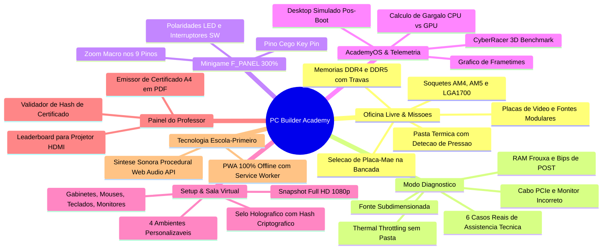
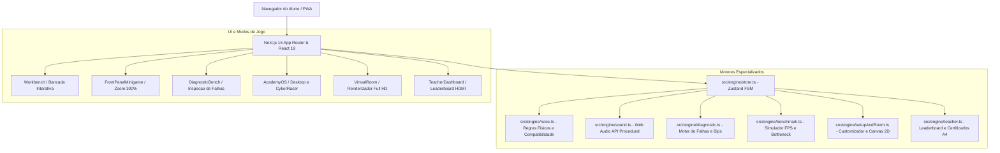

# 🛠️ PC Builder Academy (v3.1)

[](https://nextjs.org/)
[](https://react.dev/)
[](https://www.typescriptlang.org/)
[](https://tailwindcss.com/)
[](https://vitest.dev/)
[](https://playwright.dev/)
[](https://threejs.org/)
[](./src/engine/hardwareCatalog.ts)
[](https://developer.mozilla.org/en-US/docs/Web/API/Web_Audio_API)
[](https://web.dev/progressive-web-apps/)
[](./LICENSE)

> **Plataforma Educacional Gamificada de Arquitetura de Computadores, Montagem de Hardware, Diagnóstico Técnico e Salas Virtuais para o Ensino Médio.**

---

## 🎯 Visão Geral & Proposta Pedagógica

O **PC Builder Academy** foi projetado para transformar o ensino de **Arquitetura de Computadores e Montagem de Hardware** nas salas de aula e laboratórios de informática do **Ensino Médio** (especialmente turmas de 1º ano e cursos técnicos de TI / Informática).

Nas escolas, o ensino de montagem de computadores costuma enfrentar barreiras críticas: alto custo de peças, risco de queima de componentes por eletricidade estática ou pinos entortados, escassez de laboratórios equipados e computadores desatualizados. 

O **PC Builder Academy** soluciona esse gargalo oferecendo uma experiência imersiva, tátil e 100% segura, com fidelidade física real, cálculo de gargalo de processamento (*bottleneck*), minigame de alta precisão para conectores do painel frontal (`F_PANEL`), resolução de defeitos de assistência técnica e personalização de setups completos com exportação de fotos Full HD.

---

## 🆕 Novidades da v2.1 à v3.1

| Área | O que mudou | Documentação |
| :--- | :--- | :--- |
| Regras e conteúdo (v2.1) | Fases derivadas do estado, F_PANEL com polaridade real, cabeamento completo da placa, ilustrações orientadas por dados, catálogo com +70 peças com todos os campos das regras validados em teste (#19–#23) | [ADR-008](./docs/adr/ADR-008-fases-derivadas-e-regras-de-montagem.md), [ADR-009](./docs/adr/ADR-009-ilustracoes-orientadas-por-dados.md), [ADR-010](./docs/adr/ADR-010-cabeamento-e-arrastar-e-soltar.md) |
| Bancada 3D | Medidas reais dos GLBs, encaixe verificado em 743.808 montagens, todos os conectores também no 3D, alavanca do soquete, GPU parafusada, disco SATA na baia | [ADR-011](./docs/adr/ADR-011-visualizacao-3d-hibrida.md) |
| Mesa Battlestation | Periféricos, cabos externos, tela viva e arranjo verificado em 24.192 combinações | [ADR-012](./docs/adr/ADR-012-mesa-battlestation-e-cabeamento-externo.md) |
| Campanha | 35 missões sequenciais em 5 trilhas, progresso salvo, código verificável com SHA-256 | [ADR-005](./docs/adr/ADR-005-gamificacao-e-desafio-em-grupos.md) |
| Pontuação | Pontuação pura com benchmark real, gargalo e alertas do POST (#26) | ADR-005 |
| Diagnóstico | Modo detetive: hipótese antes de abrir a máquina, pontos por tentativa, chamados sorteados, casos de cabeamento (#32) | — |
| Professor | Relatório de erros da turma, CSV e habilidades do certificado ligadas à BNCC Computação (#34) | — |
| Abrir o PC | Vista explodida, isolamento de subsistemas com leituras do benchmark, tour por ociosidade e níveis de qualidade para vídeo integrado (#38, #59–#63) | [ADR-013](./docs/adr/ADR-013-modo-abrir-o-pc.md) |
| **Modo Orçamento** | Desafio de Orçamento sem turma: perfis de cliente, prévia de viabilidade, saldo ao vivo, "cabe no saldo" nos cards, pontuação de custo-benefício e ranking puro (#66–#70) | [Relatório da feature](./docs/relatorio-modo-orcamento.md) |
| **Modo Decorar o Quarto** | Com o PC ligado na mesa, o aluno decora o quarto em 3D: 74 itens em 4 pacotes liberados por conquistas, arrastar ou clicar, teclado completo, recusas didáticas, itens por código (fita LED, hexágonos, neon com texto, pôsteres com os dados do PC), quarto salvo e foto 1920 × 1080 (#83–#91) | [Relatório da feature](./docs/relatorio-modo-decorar-quarto.md) |
| **Modo Professor online** | Login do professor sem e-mail, turmas com código, atividades (missão, desafio, diagnóstico, Modo Orçamento), entrada do aluno com apelido, pontuação oficial no servidor, ranking ao vivo, telão, relatório e CSV, no banco Neon da Vercel (#71–#81) | [Relatório da feature](./docs/relatorio-modo-professor.md) |
| PWA e desempenho | Cache versionado pelo build com aviso de nova versão, `/api/` fora do cache, relógio isolado do HUD (#24, #31, #66) | [pwa-atualizacao.md](./docs/pwa-atualizacao.md), [performance.md](./docs/performance.md) |
| Qualidade | ESLint no CI, Playwright com arraste real, teclado e tela de 375 px (#33) | `.github/workflows/ci.yml` |

---

## 🚀 Principais Funcionalidades



### 1. 🛠️ Bancada Interativa (3D Realista & 2D Leve) & Oficina Livre
* **Bancada 3D Interativa com Calibração Física Fidedigna:** O aluno experimenta uma bancada virtual completa de testes de engenharia com tapete antiestático escuro, iluminação técnica e modelos GLB hiper-realistas:
  * **Dual Plataforma AMD & Intel:** Modelos físicos dedicados para **Intel LGA1700** (`mb-z790-atx.glb`) e **AMD AM4/AM5** (`mb-b550m.glb`) com calibração milimétrica de soquetes, slots DIMM de memória, M.2 NVMe, PCIe x16 e conectores elétricos.
  * **Assentamento Direto Holográfico 3D:** Quando a bancada estiver vazia, o tapete antiestático exibe o holograma demarcador e um card 3D flutuante para posicionar a placa com um clique direto.
  * **Affordances e Pinos Inteligentes:** Pinos circulares contextuais sem qualquer sobreposição ou amontoamento visual. Os detalhes técnicos expandem com animações suaves no *hover* ou navegação por teclado.
  * **Persistência Bidirecional 100% 2D <-> 3D:** Alternância transparente entre o modo 3D e o modo 2D leve (gráfico vetorial SVG, ideal para economia de energia em laptops escolares), preservando integralmente o estado das peças instaladas, alavanca, pasta térmica, coolers e cabeamento.
  * **Modo "Levar ao Gabinete":** Transição direta para o gabinete 3D envolvente com tampa de vidro temperado interativa e ventoinhas giratórias acionadas pelo POST.
  * **Menu Lateral de Escolha de Componentes & Cabeamento:** Navegação ágil com busca instantânea, selos de compatibilidade em tempo real e categorias individualizadas (com separação independente de Coolers e Pastas Térmicas).
* **Física Real de Montagem:**
  * Alavanca do soquete da CPU com trava de pressão mecânica.
  * Aplicação e espalhamento de gota de pasta térmica metálica sobre o IHS.
  * Parafusamento de Coolers Torre e Water Coolers (AIO 240mm) sobre a CPU com pasta térmica pré-requisito obrigatório.
  * Encaixe vertical de pentes de memórias RAM nos slots DIMM recomendados (Dual Channel Slots 2 e 4).
  * Parafusamento de SSDs M.2 NVMe com dissipadores térmicos.
  * Instalação de placas de vídeo no slot PCIe x16 com alimentação obrigatória via cabo PCIe 8 pinos.
  * Conexão de cabos modulares (ATX 24 pinos, EPS 8 pinos, PCIe 8 pinos, CPU_FAN e Painel Frontal F_PANEL com retenção de estado).
* **Catálogo Amplo com Marcas e Modelos Reais (+70 Componentes Oficiais):**
  * **Placas-Mãe:** ASUS (ROG Maximus Z790, ROG Strix B650E-F / B760-I ITX, TUF Gaming B550M / B650-Plus, Prime H610M), MSI (MAG Tomahawk B550 / Z790, MAG Mortar B650M / B760M, PRO B760M), Gigabyte (AORUS Elite B650M / B550M, DS3H), ASRock (Steel Legend).
  * **Processadores:** Linha AMD Ryzen (3600, 4600G com iGPU Vega 7, 5600, 5700X3D com 3D V-Cache, 5900X 12C, 7600, 8600G com NPU Ryzen AI, 7700X, 7800X3D o campeão dos jogos, 7950X 16C) e Intel Core (i3-12100/F, i5-12400F, i5-13400F, i5-13600K, i7-13700K, i7-14700K, i9-14900K até 6.0 GHz).
  * **Memórias RAM:** Kingston Fury (Beast, Renegade RGB até 64GB), Corsair (Vengeance LPX, Vengeance RGB, Dominator Titanium), G.Skill (Trident Z5 Neo RGB AMD EXPO, Ripjaws V), XPG (Spectrix D45G, Lancer Blade) em frequências de 3200MHz a 6400MHz.
  * **Coolers & Pastas Térmicas:** DeepCool (AG400, LE520 240mm ARGB), Noctua (NH-D15 chromax.black silencioso), Thermalright (Peerless Assassin 120 SE), NZXT (Kraken Elite 360 LCD), Corsair (iCUE H100i), Arctic (MX-4, MX-6), Thermal Grizzly (Kryonaut Extreme), Noctua (NT-H1) e Implastec.
  * **Placas de Vídeo:** Séries NVIDIA GeForce (GTX 1650, RTX 3050, RTX 3060 12GB, RTX 4060, RTX 4070 Super, RTX 4070 Ti Super, RTX 4090 24GB) e AMD Radeon (RX 6600, RX 6700 XT, RX 7600, RX 7800 XT 16GB, RX 7900 XTX 24GB) das marcas ASUS, MSI, Gigabyte, Sapphire, Galax, XFX.
  * **Armazenamento:** NVMe PCIe 4.0/5.0 e SATA de alto desempenho das marcas Kingston (NV2, KC3000), Samsung (980 PRO, 990 PRO), Western Digital (WD_BLACK SN770, WD Blue), Crucial (P3 Plus, BX500), Corsair (MP700 PRO PCIe 5.0 a 12.400 MB/s), Seagate (BarraCuda 2TB).
  * **Fontes:** Corsair (CV650, RM750e ATX 3.0, RM850x Gold), MSI (MAG A500DN, A650BN), XPG (Core Reactor 750W Tier A), ASUS (ROG Thor 1000W Platinum com display OLED), Cooler Master (MWE 550W).
  * **Gabinetes:** Lian Li (O11 Dynamic EVO Aquário Duplo Vidro), Corsair (4000D Airflow Branco), NZXT (H6 Flow Dual Chamber), Montech (Air 100 ARGB), Pichau (Kazan 2 Mesh), TGT (Combat Slim Office).

### 2. 🎯 Missões com Orçamento & Arena Speedrun
* **Missões Didáticas:** Montagens guiadas com limites de orçamento em Reais (R$) e requisitos específicos (ex: *PC Home Office R$ 2.500*, *PC Gamer Competitivo R$ 5.500*, *Estação de Render 3D R$ 12.000*).
* **Arena de Desafios:** Modo cronometrado estilo *Speedrun* com sistema de 0 a 10.000 pontos escolares, contabilizando bônus de velocidade e aplicando penalidades rígidas por erros de compatibilidade física.

### 3. 🔍 Modo Diagnóstico ("O que está quebrado? / Detetive de Hardware")
Simulação real de bancada de assistência técnica onde o aluno recebe PCs com sintomas de falha e precisa investigar, identificar a causa raiz e consertar o equipamento:
1. **Memória RAM Mal Encaixada:** PC não dá vídeo e emite sequência de bips longos contínuos.
2. **Pasta Térmica Ausente:** PC liga, mas sofre *thermal throttling* e desliga por superaquecimento a 100°C.
3. **Fonte Subdimensionada:** PC desliga repentinamente ao rodar teste de estresse de carga pesada.
4. **Cooler de CPU Desconectado:** Placa-mãe acusa erro de `CPU Fan Error` na BIOS.
5. **GPU sem Alimentação PCIe:** Sem sinal de vídeo devido ao esquecimento do cabo auxiliar de 8 pinos.
6. **Monitor na Saída Incorreta:** Cabo HDMI plugado na placa-mãe em um processador sem gráficos integrados.

### 4. 🔌 Minigame Painel Frontal (`F_PANEL`) com Zoom 300%
* O terror clássico de quem monta PCs pela primeira vez transformado em minigame didático.
* Visão macro de 300% sobre o bloco de 9 pinos da placa-mãe:
  * `POWER SW` (Interruptor de Força - sem polaridade crítica).
  * `RESET SW` (Interruptor de Reinicialização).
  * `POWER LED +` e `POWER LED -` (LED de Ligado - polaridade estrita).
  * `HDD LED +` e `HDD LED -` (LED de Atividade de Disco - polaridade estrita).
  * Identificação do *Key Pin* (pino ausente/cego para orientação espacial).

### 5. 💻 AcademyOS Desktop & CyberRacer Benchmark
* Sistema operacional desktop simulado pós-POST com sons clássicos de inicialização.
* **Telemetria em Tempo Real:** Sensores de frequência de clock (GHz), temperatura de operação (°C) e consumo elétrico instantâneo (W).
* **CyberRacer 3D Benchmark:** Demonstração interativa de teste gráfico calculando:
  * FPS Médio, 1% Low e 0.1% Low.
  * Gráfico contínuo de *Frametime* (latência de quadros em milissegundos).
  * **Cálculo Analítico de Gargalo (*Bottleneck Ratio*):** Diagnóstico matemático se o gargalo é de CPU (processador fraco com GPU topo de linha) ou de GPU (gráfico integrado tentando rodar 4K).

### 6. 🖥️ Setup de Periféricos & Sala Virtual do Aluno
* O aluno ultrapassa os limites do gabinete e customiza sua estação completa de estudos/jogos:
  * **Gabinetes:** Aquário com vidro temperado, Minimalista silencioso ou Mesh Flow de alto fluxo de ar.
  * **Periféricos:** Monitores (Single, Dual Monitor, Ultrawide Curvo), Teclados Mecânicos (RGB, 60%, ABNT2), Mouses de alta precisão, Gamepads e Braços Articulados com mola a gás.
  * **Ambientes:** *Quarto Gamer RGB Neon*, *Escritório Minimalista Escandinavo*, *Laboratório Tech Escolar* e *Clean Studio*.
* **Exportação Fotográfica Full HD 1080p (Canvas 2D):**
  * O aluno pode baixar a foto de sua sala virtual montada em PNG (1920x1080).
  * A imagem gerada contém o **Selo Holográfico de Certificação Oficial** com identificador criptográfico (`PCA-XXXXXX`), nome do aluno, especificações da máquina e data de conclusão.

### 7. 🎓 Painel do Professor & Certificados Oficiais
* **Leaderboard para Telão / Projetor:** Modo de exibição de alta visibilidade para projetar o ranking da turma em sala de aula (tempo, pontuação, compatibilidade).
* **Validador de Autenticidade:** Campo para o professor digitar a hash do certificado (`PCA-XXXXXX`) e validar instantaneamente os dados do aluno.
* **Emissor de Certificado A4 em PDF:** Geração de Certificado de Conclusão profissional em formato A4 Paisagem com suporte nativo a impressão (`Ctrl+P` / `window.print`).

### 8. 📴 Arquitetura Escola-Primeiro (PWA & Áudio Procedural)
* **Zero Dependência de Internet (PWA):** Instalação local como aplicativo e cache automático via Service Worker (`sw.js`). Se a conexão da escola oscilar ou cair, o jogo continua funcionando 100%.
* **Síntese de Áudio Procedural (Web Audio API):**
  * Zero downloads de arquivos MP3 pesados.
  * Sons calculados matematicamente no navegador: clique mecânico das travas de RAM, som metálico da alavanca do soquete da CPU, rotação de ventoinhas e o clássico bip de 800 Hz do POST de inicialização.

---

## 🏛️ Arquitetura do Software



### Estrutura de Diretórios

```
NEXT-GAME-ARQ/
├── docs/                      # PRD, ADRs (001 a 013), design system, relatórios e roteiros de teste
├── e2e/                       # Playwright (1366x768 e 375 px); e2e/support com os passos de interface
├── public/                    # PWA (manifest, sw.js versionado pelo build), modelos GLB e ícones
├── scripts/                   # Otimização e medição dos modelos 3D (npm run models:optimize / models:measure)
├── src/
│   ├── app/                   # App Router: jogo, painel do professor (/professor), API (/api/v1) e /t/[codigo]
│   ├── components/            # Interface: bancada 2D/3D, mesa, campanha, diagnóstico, professor, HUD, PWA
│   │   └── room3d/            # Modo Decorar o Quarto (carregado sob demanda): quarto, gaveta, foto
│   ├── engine/                # Regras puras em TypeScript (sem React): compatibilidade, fases, benchmark,
│   │                          #   geometria 3D, campanha, orçamento, pontuação, ranking, detetive, corte,
│   │                          #   quarto (catálogo, posicionamento e desbloqueios da decoração)
│   │   └── __tests__/         # Testes do motor (Vitest)
│   ├── server/                # Só no servidor: repositório (Neon e memória), autenticação e handlers da API
│   └── store/                 # Zustand: montagem (persistida), progresso, quarto decorado, turma e armazenamento seguro
└── .github/workflows/ci.yml   # tsc, ESLint, Vitest, build e Playwright
```

---

## 🧪 Suíte de Testes Automatizados (Vitest)

O projeto segue rigorosamente o princípio de **Test-Driven Development (TDD)** para todas as regras de compatibilidade física, diagnósticos e cálculos de gargalo.

```bash
# Executar a suíte de testes completa
npm test
```

### Cobertura de testes
* **Vitest (mais de 500 testes em 40 arquivos):** regras de compatibilidade, fases e checklist, benchmark, geometria da bancada (743.808 montagens) e da mesa (24.192 combinações), campanha, detetive, pontuação, Modo Orçamento (busca exaustiva comparada com força bruta, < 200 ms), ranking, relatório da turma, código verificável e service worker.
* **Playwright (mais de 40 testes):** montagem completa só pela interface (AMD e Intel) com a física conferida na cena 3D, fluxo completo do Desafio de Orçamento até o PC na mesa, Abrir o PC, mesa e cabos externos, arraste real, teclado, campanha, detetive, relatório do professor e tela de 375 px.

```bash
npm test               # Vitest
npm run test:e2e       # Playwright (sobe o servidor de desenvolvimento)
```

---

## 💻 Como Executar Localmente

### Pré-requisitos
* **Node.js** v18.18+ ou v20+ instalado.
* **npm** ou **bun** / **pnpm** / **yarn**.

### Passo a Passo

1. **Clone o repositório:**
   ```bash
   git clone https://github.com/narcisojunior-dev/NEXT-GAME-ARQ.git
   cd NEXT-GAME-ARQ
   ```

2. **Instale as dependências:**
   ```bash
   npm install
   ```

3. **Inicie o servidor de desenvolvimento:**
   ```bash
   npm run dev
   ```
   Abra no seu navegador: [http://localhost:3000](http://localhost:3000)

4. **Executar build de produção:**
   ```bash
   npm run build
   npm run start
   ```

### Modo Professor online (opcional)
Sem banco, o painel `/professor` e a API usam a memória do servidor (os dados somem ao reiniciar).
Para usar o banco Neon do projeto na Vercel:

```bash
npx vercel link                     # liga a pasta ao projeto
npx vercel env pull .env.local      # traz DATABASE_URL (e CLASSROOM_SECRET, se cadastrado)
npm run db:migrate                  # cria as tabelas (idempotente)
```

Variáveis do projeto na Vercel: `DATABASE_URL` (criada pela integração do Neon), `CLASSROOM_SECRET`
(segredo da sessão do professor, mínimo de 32 caracteres) e `CRON_SECRET` (rotina diária de
retenção). Detalhes em [relatorio-modo-professor.md](./docs/relatorio-modo-professor.md).

---

## 🇧🇷 Alinhamento Pedagógico com a BNCC

O **PC Builder Academy** atende diretamente aos objetivos de aprendizagem das Diretrizes Curriculares Nacionais e da **Base Nacional Comum Curricular (BNCC)** para a área de **Ciências da Natureza e suas Tecnologias** e as **Normas sobre Computação na Educação Básica (Resolução CNE/CP nº 1/2022)**:

* **Competência Específica 1 (Mundo Digital e Hardware):** Compreender o funcionamento interno de dispositivos computacionais, a interconexão de barramentos (PCI Express, SATA, canais de memória) e o papel da Unidade Central de Processamento (CPU), memória de acesso aleatório (RAM) e dispositivos de armazenamento massivo.
* **Habilidade EM13MAT101 & EM13CNT301:** Análise de grandezas físicas e elétricas: cálculo de potência e consumo elétrico (Watts/TDP), dimensionamento de fontes de alimentação e transferência de calor (dissipação térmica por pasta térmica e *air cooler*).
* **Pensamento Computacional & Resolução de Problemas:** Diagnóstico sistemático de erros (*troubleshooting*), raciocínio hipotético-dedutivo na investigação de falhas de hardware e formulação de soluções técnicas baseadas em evidências empíricas.

---

## 🤝 Padrão de Contribuição & Conventional Commits

Todas as alterações no repositório seguem estritamente a especificação [Conventional Commits](https://www.conventionalcommits.org/):

* `feat:` Adição de novo componente ou modo de jogo.
* `fix:` Correção de bug no motor de regras ou interface.
* `docs:` Atualizações de documentação, PRD ou ADRs.
* `test:` Adição ou modificação de testes unitários no Vitest.
* `refactor:` Melhorias internas de código sem alteração de comportamento.
* `style:` Ajustes finos de Tailwind CSS e micro-interações.

---

## 📄 Licença

Este projeto é distribuído sob a licença **MIT**. Consulte o arquivo [LICENSE](./LICENSE) para obter mais informações.

Desenvolvido para inspirar a próxima geração de engenheiros de computação e técnicos de tecnologia do Brasil! 🇧🇷⚡

