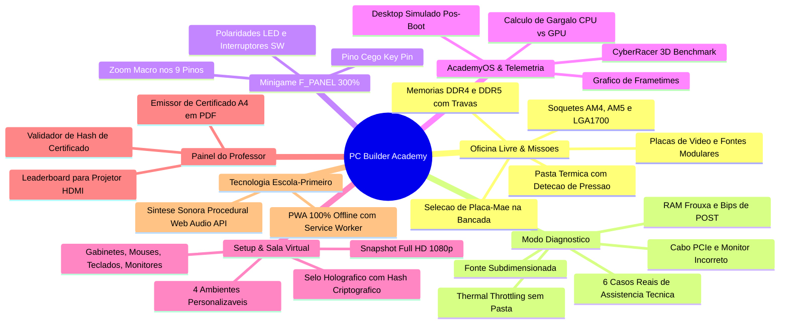
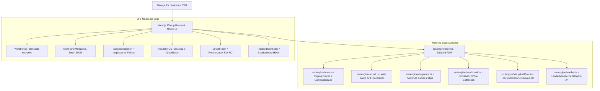

# 🛠️ PC Builder Academy (v2.0)

[](https://nextjs.org/)
[](https://react.dev/)
[](https://www.typescriptlang.org/)
[](https://tailwindcss.com/)
[](https://vitest.dev/)
[](https://developer.mozilla.org/en-US/docs/Web/API/Web_Audio_API)
[](https://web.dev/progressive-web-apps/)
[](./LICENSE)

> **Plataforma Educacional Gamificada de Arquitetura de Computadores, Montagem de Hardware, Diagnóstico Técnico e Salas Virtuais para o Ensino Médio.**

---

## 🎯 Visão Geral & Proposta Pedagógica

O **PC Builder Academy** foi projetado para transformar o ensino de **Arquitetura de Computadores e Montagem de Hardware** nas salas de aula e laboratórios de informática do **Ensino Médio** (especialmente turmas de 1º ano e cursos técnicos de TI / Informática).

Nas escolas, o ensino de montagem de computadores costuma enfrentar barreiras críticas: alto custo de peças, risco de queima de componentes por eletricidade estática ou pinos entortados, escassez de laboratórios equipados e computadores desatualizados. 

O **PC Builder Academy** soluciona esse gargalo oferecendo uma experiência imersiva, tátil e 100% segura, com fidelidade física real, cálculo de gargalo de processamento (*bottleneck*), minigame de alta precisão para conectores do painel frontal (`F_PANEL`), resolução de defeitos de assistência técnica e personalização de setups completos com exportação de fotos Full HD.

---

## 🚀 Principais Funcionalidades



### 1. 🛠️ Bancada Interativa & Oficina Livre
* **Bancada Limpa com Seleção de Placa-Mãe:** O aluno inicia na bancada antiestática e escolhe a placa-mãe apropriada (**AMD AM4 B550**, **AMD AM5 B650**, **Intel LGA1700 B760** ou **Mini-ITX Z790**).
* **Física Real de Montagem:**
  * Alavanca do soquete da CPU com trava de pressão mecânica.
  * Aplicação e espalhamento de pasta térmica (*thermal compound*).
  * Encaixe de memórias RAM com abertura prévia de travas laterais.
  * Parafusamento de SSDs M.2 NVMe com dissipadores térmicos.
  * Instalação de placas de vídeo no slot PCIe x16 com trava de retenção.
  * Conexão de cabos modulares (ATX 24 pinos, EPS 8 pinos, PCIe 8 pinos e SATA).
* **Catálogo Amplo de Componentes:** Processadores (Ryzen 5 5600, Ryzen 7 7800X3D, Core i5-13400, Core i7-14700K), Memórias RAM (DDR4 3200MHz, DDR5 6000MHz), Placas de Vídeo (RTX 3060, RTX 4070 Super, RX 7600), Fontes de 500W a 850W 80 Plus Gold e Gabinetes diversos.

### 2. 🎯 Missões com Orçamento & Arena Speedrun
* **Missões Didáticas:** Montagens guiadas com limites de orçamento em Reais (R$) e requisitos específicos (ex: *PC Home Office R$ 2.500*, *PC Gamer Competitivo R$ 5.500*, *Estação de Render 3D R$ 12.000*).
* **Arena de Desafios:** Modo cronometrado estilo *Speedrun* com sistema de 0 a 10.000 pontos escolares, contabilizando bônus de velocidade e aplicando penalidades rígidas por erros de compatibilidade física.

### 3. 🔍 Modo Diagnóstico ("O que está quebrado? / Detetive de Hardware")
Simulação real de bancada de assistência técnica onde o aluno recebe PCs com sintomas de falha e precisa investigar, identificar a causa raiz e consertar o equipamento:
1. **Memória RAM Mal Encaixada:** PC não dá vídeo e emite sequência de bips longos contínuos.
2. **Pasta Térmica Ausente:** PC liga, mas sofre *thermal throttling* e desliga por superaquecimento a 100°C.
3. **Fonte Subdimensionada:** PC desliga repentinamente ao rodar teste de estresse de carga pesada.
4. **Cooler de CPU Desconectado:** Placa-mãe acusa erro de `CPU Fan Error` na BIOS.
5. **GPU sem Alimentação PCIe:** Sem sinal de vídeo devido ao esquecimento do cabo auxiliar de 8 pinos.
6. **Monitor na Saída Incorreta:** Cabo HDMI plugado na placa-mãe em um processador sem gráficos integrados.

### 4. 🔌 Minigame Painel Frontal (`F_PANEL`) com Zoom 300%
* O terror clássico de quem monta PCs pela primeira vez transformado em minigame didático.
* Visão macro de 300% sobre o bloco de 9 pinos da placa-mãe:
  * `POWER SW` (Interruptor de Força - sem polaridade crítica).
  * `RESET SW` (Interruptor de Reinicialização).
  * `POWER LED +` e `POWER LED -` (LED de Ligado - polaridade estrita).
  * `HDD LED +` e `HDD LED -` (LED de Atividade de Disco - polaridade estrita).
  * Identificação do *Key Pin* (pino ausente/cego para orientação espacial).

### 5. 💻 AcademyOS Desktop & CyberRacer Benchmark
* Sistema operacional desktop simulado pós-POST com sons clássicos de inicialização.
* **Telemetria em Tempo Real:** Sensores de frequência de clock (GHz), temperatura de operação (°C) e consumo elétrico instantâneo (W).
* **CyberRacer 3D Benchmark:** Demonstração interativa de teste gráfico calculando:
  * FPS Médio, 1% Low e 0.1% Low.
  * Gráfico contínuo de *Frametime* (latência de quadros em milissegundos).
  * **Cálculo Analítico de Gargalo (*Bottleneck Ratio*):** Diagnóstico matemático se o gargalo é de CPU (processador fraco com GPU topo de linha) ou de GPU (gráfico integrado tentando rodar 4K).

### 6. 🖥️ Setup de Periféricos & Sala Virtual do Aluno
* O aluno ultrapassa os limites do gabinete e customiza sua estação completa de estudos/jogos:
  * **Gabinetes:** Aquário com vidro temperado, Minimalista silencioso ou Mesh Flow de alto fluxo de ar.
  * **Periféricos:** Monitores (Single, Dual Monitor, Ultrawide Curvo), Teclados Mecânicos (RGB, 60%, ABNT2), Mouses de alta precisão, Gamepads e Braços Articulados com mola a gás.
  * **Ambientes:** *Quarto Gamer RGB Neon*, *Escritório Minimalista Escandinavo*, *Laboratório Tech Escolar* e *Clean Studio*.
* **Exportação Fotográfica Full HD 1080p (Canvas 2D):**
  * O aluno pode baixar a foto de sua sala virtual montada em PNG (1920x1080).
  * A imagem gerada contém o **Selo Holográfico de Certificação Oficial** com identificador criptográfico (`PCA-XXXXXX`), nome do aluno, especificações da máquina e data de conclusão.

### 7. 🎓 Painel do Professor & Certificados Oficiais
* **Leaderboard para Telão / Projetor:** Modo de exibição de alta visibilidade para projetar o ranking da turma em sala de aula (tempo, pontuação, compatibilidade).
* **Validador de Autenticidade:** Campo para o professor digitar a hash do certificado (`PCA-XXXXXX`) e validar instantaneamente os dados do aluno.
* **Emissor de Certificado A4 em PDF:** Geração de Certificado de Conclusão profissional em formato A4 Paisagem com suporte nativo a impressão (`Ctrl+P` / `window.print`).

### 8. 📴 Arquitetura Escola-Primeiro (PWA & Áudio Procedural)
* **Zero Dependência de Internet (PWA):** Instalação local como aplicativo e cache automático via Service Worker (`sw.js`). Se a conexão da escola oscilar ou cair, o jogo continua funcionando 100%.
* **Síntese de Áudio Procedural (Web Audio API):**
  * Zero downloads de arquivos MP3 pesados.
  * Sons calculados matematicamente no navegador: clique mecânico das travas de RAM, som metálico da alavanca do soquete da CPU, rotação de ventoinhas e o clássico bip de 800 Hz do POST de inicialização.

---

## 🏛️ Arquitetura do Software



### Estrutura de Diretórios

```
d:\dev\NEXT-ARQ/
├── docs/                      # Documentação de Engenharia e Design
│   ├── PRD.md                 # Product Requirements Document v2.0
│   ├── design-system.md       # Design System Cyber-Industrial & Ambientes
│   └── adr/                   # Architecture Decision Records (ADR-001 a ADR-007)
├── public/                    # Manifest PWA, Service Worker e Ícones
│   ├── manifest.json          # Configuração PWA instalável
│   ├── sw.js                  # Service Worker com cache offline
│   └── icons/                 # Ícones 192x192 e 512x512
├── src/
│   ├── app/                   # App Router Next.js 15
│   │   ├── layout.tsx         # Layout principal com registro do Service Worker
│   │   ├── page.tsx           # Hub de Navegação (Bancada, Diagnóstico, Sala, etc.)
│   │   └── globals.css        # Tailwind CSS v4 e estilos de impressão A4
│   ├── components/            # Componentes Modulares da Interface
│   │   ├── Workbench.tsx      # Bancada de montagem com seleção de placa-mãe
│   │   ├── MotherboardView.tsx# Placa-mãe vetorial interativa em SVG
│   │   ├── FrontPanelMinigame.tsx # Minigame com zoom nos 9 pinos do F_PANEL
│   │   ├── DiagnosticBench.tsx# Bancada do Modo Diagnóstico
│   │   ├── AcademyOS.tsx      # Sistema operacional desktop simulado
│   │   ├── BenchmarkModal.tsx # Benchmark CyberRacer 3D e gráfico de frametime
│   │   ├── SetupCustomizer.tsx# Customizador de gabinete e periféricos
│   │   ├── VirtualRoomView.tsx# Sala virtual do aluno e exportador 1080p
│   │   └── TeacherDashboard.tsx# Painel do Professor, Leaderboard e Certificados
│   ├── engine/                # Motor de Regras e Lógica em TypeScript Puro
│   │   ├── rules.ts           # Validador de soquetes, TDP, memórias e montagem
│   │   ├── sound.ts           # Sintetizador procedural Web Audio API
│   │   ├── diagnostic.ts      # Casos de assistência técnica e injeção de falhas
│   │   ├── benchmark.ts       # Fórmulas de FPS, latência e gargalo CPU/GPU
│   │   ├── setupAndRoom.ts    # Configuração de periféricos, salas e selo
│   │   ├── teacher.ts         # Pontuações escolares, hash e certificados A4
│   │   ├── store.ts           # Máquina de estados global em Zustand
│   │   └── __tests__/         # 35 Testes Unitários e de Integração em Vitest
│   └── types/                 # Definições de Tipos TypeScript
│       └── hardware.ts        # Interfaces completas de componentes e estados
└── package.json               # Dependências e scripts de execução
```

---

## 🧪 Suíte de Testes Automatizados (Vitest)

O projeto segue rigorosamente o princípio de **Test-Driven Development (TDD)** para todas as regras de compatibilidade física, diagnósticos e cálculos de gargalo.

```bash
# Executar a suíte de testes completa
npm test
```

### Cobertura de Testes (35 testes aprovados):
* `compatibility.test.ts` (9 testes): Soquetes AM4 vs AM5 vs LGA1700, DDR4 vs DDR5, trava de memória, pasta térmica e travas de soquete.
* `frontPanel.test.ts` (7 testes): Mapeamento de pinos, conexões corretas de POWER SW, HDD LED com polaridade (+/-) e rejeição de conexões inválidas.
* `diagnostic.test.ts` (7 testes): 6 cenários reais de assistência técnica, validação de correções e verificação de máquina saudável.
* `benchmark.test.ts` (5 testes): Fórmulas matemáticas de FPS, detecção de gargalo (*Bottleneck*) de CPU vs GPU e limites de frametime.
* `setupAndRoom.test.ts` (4 testes): Seleção de periféricos, cálculo de consumo de periféricos e temas de sala virtual.
* `teacher.test.ts` (3 testes): Cálculo de pontuação escolar (0 a 10.000 pts), geração e validação de hash criptográfico de certificado (`PCA-XXXXXX`).

---

## 💻 Como Executar Localmente

### Pré-requisitos
* **Node.js** v18.18+ ou v20+ instalado.
* **npm** ou **bun** / **pnpm** / **yarn**.

### Passo a Passo

1. **Clone o repositório:**
   ```bash
   git clone https://github.com/narcisojunior-dev/NEXT-GAME-ARQ.git
   cd NEXT-GAME-ARQ
   ```

2. **Instale as dependências:**
   ```bash
   npm install
   ```

3. **Inicie o servidor de desenvolvimento:**
   ```bash
   npm run dev
   ```
   Abra no seu navegador: [http://localhost:3000](http://localhost:3000)

4. **Executar build de produção:**
   ```bash
   npm run build
   npm run start
   ```

---

## 🇧🇷 Alinhamento Pedagógico com a BNCC

O **PC Builder Academy** atende diretamente aos objetivos de aprendizagem das Diretrizes Curriculares Nacionais e da **Base Nacional Comum Curricular (BNCC)** para a área de **Ciências da Natureza e suas Tecnologias** e as **Normas sobre Computação na Educação Básica (Resolução CNE/CP nº 1/2022)**:

* **Competência Específica 1 (Mundo Digital e Hardware):** Compreender o funcionamento interno de dispositivos computacionais, a interconexão de barramentos (PCI Express, SATA, canais de memória) e o papel da Unidade Central de Processamento (CPU), memória de acesso aleatório (RAM) e dispositivos de armazenamento massivo.
* **Habilidade EM13MAT101 & EM13CNT301:** Análise de grandezas físicas e elétricas: cálculo de potência e consumo elétrico (Watts/TDP), dimensionamento de fontes de alimentação e transferência de calor (dissipação térmica por pasta térmica e *air cooler*).
* **Pensamento Computacional & Resolução de Problemas:** Diagnóstico sistemático de erros (*troubleshooting*), raciocínio hipotético-dedutivo na investigação de falhas de hardware e formulação de soluções técnicas baseadas em evidências empíricas.

---

## 🤝 Padrão de Contribuição & Conventional Commits

Todas as alterações no repositório seguem estritamente a especificação [Conventional Commits](https://www.conventionalcommits.org/):

* `feat:` Adição de novo componente ou modo de jogo.
* `fix:` Correção de bug no motor de regras ou interface.
* `docs:` Atualizações de documentação, PRD ou ADRs.
* `test:` Adição ou modificação de testes unitários no Vitest.
* `refactor:` Melhorias internas de código sem alteração de comportamento.
* `style:` Ajustes finos de Tailwind CSS e micro-interações.

---

## 📄 Licença

Este projeto é distribuído sob a licença **MIT**. Consulte o arquivo [LICENSE](./LICENSE) para obter mais informações.

Desenvolvido para inspirar a próxima geração de engenheiros de computação e técnicos de tecnologia do Brasil! 🇧🇷⚡
