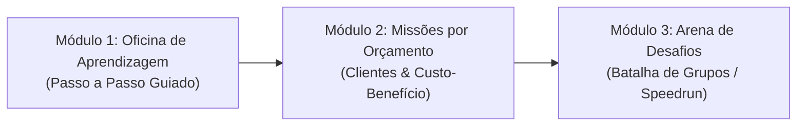
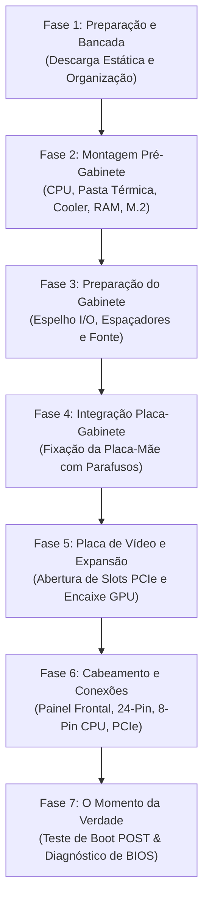

# PRD — Plataforma Educativa "PC Builder Academy" (Nome Provisório)
### Jogo Educativo e Interativo de Montagem de Computadores para o Ensino Médio

---

## 1. Visão Geral do Produto

### 1.1 Objetivo
O **PC Builder Academy** é uma aplicação web gamificada, interativa e pedagógica projetada especificamente para estudantes do **1º Ano do Ensino Médio** (faixa etária de 14 a 16 anos). O objetivo central é ensinar **todo o processo real de montagem de computadores**, a **ordem canônica e segura dos procedimentos**, as **funções e papéis técnicos de cada componente**, os **princípios de compatibilidade física e lógica**, e a **gestão de custos x desempenho**, preparando os alunos tanto para o uso consciente da tecnologia quanto para potenciais carreiras técnicas e de engenharia.

### 1.2 Proposta de Valor Pedagógica
Diferente de simuladores comerciais complexos que focam apenas no visual ou quizzes teóricos monótonos, o jogo equilibra:
1. **Interatividade Tátil-Digital:** Mecânica de bancada de trabalho com arrastar e soltar (drag-and-drop), encaixe orientado com ranhuras/notches, trava de alavancas, aplicação de pasta térmica e conexões de cabos.
2. **Causa e Efeito Realista:** Erros geram consequências pedagógicas imediatas (ex: ligar o PC sem cooler causa desligamento térmico; esquecer os espaçadores causa curto-circuito; fonte subdimensionada desarma no teste de estresse).
3. **Engajamento Competitivo e Colaborativo:** Modos de disputa cronometrada entre grupos de alunos em sala de aula, estimulando trabalho em equipe, raciocínio lógico e tomada de decisão ágil.

---

## 2. Personas e Cenários de Uso

### Persona 1: O Estudante (Ex: Lucas, 15 anos, 1º Ano do E.M.)
* **Perfil:** Curioso sobre jogos e informática, quer montar seu próprio PC gamer mas não tem recursos para errar na prática ou estragar peças caras. Tem pouca paciência para manuais de 40 páginas.
* **Necessidade:** Quer entender "para que serve cada peça", sentir a emoção de montar peça por peça e ver o PC ligar com sucesso na tela da BIOS.
* **Comportamento:** Engaja com metas claras, conquistas visuais, sons satisfatórios de encaixe ("cliques"), feedbacks humorados quando erra e ranking com os colegas de classe.

### Persona 2: O Professor (Ex: Profa. Carla, Professora de Tecnologia / Informática Aplicada)
* **Perfil:** Leciona para turmas de 30 a 40 alunos no laboratório de informática da escola ou com tablets/notebooks. Tem tempo de aula limitado (50 a 100 minutos).
* **Necessidade:** Precisa de uma ferramenta que funcione **100% no navegador sem instalação**, que ofereça um modo tutorial autoguiado (Oficina) e permita rodar uma dinâmica em grupo competitiva ("Torneio da Bancada") no final da aula.
* **Comportamento:** Precisa visualizar métricas de desempenho dos alunos (erros mais frequentes, tempo de montagem, orçamento respeitado).

---

## 3. Modos de Jogo e Jornada do Usuário

O jogo é estruturado em **3 Modos Progressivos**:

### 3.1 Modo 1: A Oficina Técnica (Passo a Passo Guiado)
* **Objetivo:** Ensinar a anatomia das peças e a ordem canônica e segura de montagem.
* **Mecânica:**
  * O aluno tem uma bancada interativa dividida em: **Mesa de Montagem**, **Inventário de Peças** e **Guia Didático Interativo (com o mascote/assistente virtual de IA)**.
  * Para cada peça selecionada, abre-se uma **Ficha Didática Visual**:
    * O que é e para que serve (analogia simples: *ex: CPU = Cérebro; RAM = Mesa de trabalho; SSD = Armário de arquivos*).
    * Onde se localiza e como se encaixa (atenção a detalhes físicos reais: chanfro do soquete, pinos, travas laterais).
    * O que acontece se errar (aviso preventivo: quebra de pinos, superaquecimento).
  * O sistema só avança para a próxima etapa se a anterior for concluída corretamente (com tolerância inteligente para caminhos alternativos válidos).

### 3.2 Modo 2: Missões por Orçamento (Clientes Reais)
* **Objetivo:** Tomada de decisão, compatibilidade cruzada e equilíbrio entre custo e desempenho.
* **Mecânica:**
  * O aluno assume uma assistência técnica e recebe solicitações de clientes fictícios:
    * **Missão 1 (PC Home Office / Estudos):** R$ 2.200 — Foco em estabilidade, bom SSD e vídeo integrado suficiente para navegação e videochamadas.
    * **Missão 2 (PC Gamer Competitivo):** R$ 4.500 — Foco em taxa de quadros (60+ FPS em 1080p), equilíbrio CPU + GPU sem gargalo (bottleneck) e fonte com selo 80 Plus.
    * **Missão 3 (Workstation de Criação e Edição 4K):** R$ 8.000 — Foco em muita memória RAM (32GB+), CPU multi-core potente, resfriamento robusto e SSD NVMe de alta velocidade.
  * O aluno gerencia uma carteira virtual. Se estourar o orçamento, o cliente recusa. Se escolher peças incompatíveis (ex: CPU AMD em placa Intel, ou fonte fraca para a GPU), o PC falha no teste de entrega.

### 3.3 Modo 3: Arena de Desafios em Grupo (Multiplayer de Sala de Aula)
* **Objetivo:** Gamificação competitiva em equipe para consolidar o aprendizado.
* **Mecânica:**
  * O professor projeta a tabela de liderança (Leaderboard) no telão da sala.
  * Os alunos (em duplas ou trios) recebem o mesmo desafio simultâneo com contagem regressiva de tempo (Timer).
  * Critérios de Pontuação:
    * **Precisão da Ordem de Montagem (40%):** Não pular etapas críticas (como pasta térmica ou espaçadores).
    * **Tempo de Execução (30%):** Bônus para agilidade sem erros.
    * **Custo-Benefício & Compatibilidade (30%):** Otimização do orçamento e pontuação de desempenho teórico no teste de benchmark.
  * Emissão de Certificado Digital / Badge para o grupo vencedor ("Técnico Mestre").

---

## 4. O Fluxo Completo de Montagem (Ordem Canônica)

O jogo modela rigorosamente as **7 Fases do Processo Real de Montagem de um Computador**:

### Detalhamento das Etapas e Interações Didáticas:

#### Fase 1: Preparação e Segurança
* **Ação do Aluno:** Arrastar a pulseira antiestática para o pulso ou clicar no componente metálico aterrado para descarregar eletricidade estática.
* **Lição Didática:** O que é ESD (Electrostatic Discharge) e como uma descarga invisível pode queimar circuitos integrados sensíveis (MOSFETs, controladoras).

#### Fase 2: Montagem Pré-Gabinete (Sobre a caixa da placa-mãe)
1. **Instalação do Processador (CPU):**
   * Abrir a alavanca do soquete (LGA para Intel / AM5 ou AM4 para AMD).
   * Alinhar o triângulo dourado do processador com a marcação do soquete.
   * Colocar sem forçar (sistema ZIF — Zero Insertion Force). Fechar a alavanca.
   * *Feedback de erro:* Se tentar colocar invertido, aviso de risco de entortar pinos.
2. **Aplicação da Pasta Térmica:**
   * Aplicar a gota central (tamanho de uma ervilha) sobre o IHS (Integrated Heat Spreader).
   * *Lição Didática:* A superfície do metal parece lisa ao olho humano, mas tem microfissuras cheias de ar (que é péssimo condutor térmico). A pasta preenche esse ar.
3. **Instalação do Cooler da CPU:**
   * Encaixar a base do cooler e apertar parafusos em padrão "X" para distribuir a pressão uniformemente.
   * Conectar o cabo do ventilador no conector correto: `CPU_FAN` (e não `SYS_FAN`).
4. **Instalação da Memória RAM:**
   * Abrir as travas do slot DIMM.
   * Identificar o chanfro/entalhe central (notch) que impede encaixar ao contrário ou colocar DDR4 em slot DDR5.
   * Pressionar até ouvir o duplo "Click" das travas.
   * *Lição Didática:* Ensinar **Dual Channel** (slots 2 e 4 em placas com 4 slots).
5. **Instalação do SSD M.2 NVMe:**
   * Inserir em ângulo de 30° no slot M.2, abaixar e prender com o parafuso de retenção ou trava plástica rápida.

#### Fase 3: Preparação do Gabinete
1. **Instalação do Espelho Traseiro (I/O Shield):**
   * Encaixar de dentro para fora no fundo do gabinete até estalar os cantos.
   * *Aviso Didático Clássico:* Se esquecer agora, terá que desparafusar todo o computador mais tarde!
2. **Instalação dos Espaçadores da Placa-Mãe (Standoffs):**
   * Parafusar os pinos dourados de latão apenas nas posições que coincidem com os furos da placa-mãe (padrão ATX, Micro-ATX ou Mini-ITX).
   * *Lição Crítica:* Um espaçador sobrando atrás da placa causará curto-circuito instantâneo ao ligar.
3. **Instalação da Fonte de Alimentação (PSU):**
   * Posicionar com a ventoinha voltada para a grelha de ventilação do gabinete (com filtro de poeira).
   * Fixar com os 4 parafusos sextavados na traseira.

#### Fase 4: Fixação no Gabinete
* Baixar a placa-mãe montada alinhando as conexões traseiras no espelho e assentando sobre os espaçadores.
* Parafusar com parafusos de rosca fina sem arrochar excessivamente para não rachar as camadas internas da placa (PCB multicamadas).

#### Fase 5: Placa de Vídeo Dedicada (GPU)
* Retirar as tampas metálicas dos slots traseiros PCIe.
* Abrir a trava do slot PCIe x16 (slot superior, conectado direto à CPU).
* Inserir a GPU até o "click" e parafusar a chapa no gabinete para evitar que a placa empene com o peso (GPU sag).

#### Fase 6: O Cabeamento (Desmistificado)
O aluno conecta os cabos essenciais arrastando os conectores para seus respectivos soquetes identificados:
* **Cabo Principal 24 Pinos ATX:** Alimenta a placa-mãe e periféricos.
* **Cabo EPS 12V 8 Pinos (4+4):** Alimenta exclusivamente a CPU.
* **Cabo PCIe 8 Pinos (6+2):** Energia auxiliar para a placa de vídeo.
* **Painel Frontal (Front Panel - F_PANEL):** O clássico pesadelo dos iniciantes simplificado em um minigame com zoom:
  * `POWER SW` (botão de ligar - contato momentâneo, sem polaridade).
  * `RESET SW` (botão de reiniciar).
  * `HDD LED` (luz de atividade do disco - com polaridade + e -).
  * `POWER LED` (luz do sistema ligado - com polaridade + e -).
* **Áudio Frontal (HD Audio):** Identificado pelo pino cego (key pin).
* **USB 3.0 / USB 2.0:** Pinos de alinhamento.

#### Fase 7: O Momento do Boot (POST - Power-On Self-Test)
* Ligar o interruptor I/O da fonte.
* Pressionar o botão Power do gabinete.
* **Simulação dos Debug LEDs:**
  * Luzes acendem em sequência: `CPU` -> `DRAM` -> `VGA` -> `BOOT`.
  * Se houver falha, a luz correspondente fica acesa e o jogo dá a pista do problema.
* **Sucesso:**
  * Som clássico do *BEEP* curto do buzzer da BIOS.
  * Tela de BIOS animada surge exibindo: modelo da CPU, quantidade e frequência de memória detectada em Dual Channel, temperatura e SSD reconhecido.

---

## 5. Requisitos Funcionais e Não Funcionais

### 5.1 Requisitos Funcionais (RF)
* **RF01 (Simulador de Bancada Interativa):** O sistema deve fornecer uma bancada de montagem com slots interativos que aceitam peças via drag-and-drop e clique.
* **RF02 (Validação de Ordem Canônica):** O sistema deve validar se o usuário está respeitando a sequência de montagem ou alertar sobre desvios críticos.
* **RF03 (Ficha Técnica e Didática):** Cada componente deve dispor de card explicativo em linguagem acessível ao Ensino Médio.
* **RF04 (Motor de Compatibilidade de Hardware):** O sistema deve checar soquete (LGA1700, AM4, AM5), tipo de memória (DDR4 vs DDR5), potência da fonte (TDP total + folga de 20%), clearance físico e conexões de energia.
* **RF05 (Simulador de POST/BIOS):** Animação e som simulando a rotina de boot do computador com diagnóstico visual de falhas.
* **RF06 (Modo Missões de Orçamento):** Sistema de gestão de carteira virtual com desafios de clientes e cálculo de custo-benefício.
* **RF07 (Modo Arena Competitiva / Timer):** Temporizador, contador de precisão e cálculo de pontuação para dinâmicas em sala de aula.
* **RF08 (Áudio e Efeitos Interativos):** Efeitos sonoros mecânicos (clique de soquete, estalo de RAM, bips da placa-mãe, ventoinhas girando).

### 5.2 Requisitos Não Funcionais (RNF)
* **RNF01 (Acessibilidade e Desempenho em Escolas):** A aplicação deve rodar fluidamente a 60 FPS em computadores modestos de salas de informática escolares (gráficos integrados básicos e conexão de internet comum).
* **RNF02 (Zero Instalação):** 100% web, compatível com Chrome, Edge, Firefox e navegadores móveis/tablets.
* **RNF03 (Tempo de Carregamento):** Carregamento inicial em menos de 2 segundos, com assets vetoriais leves (SVG) e áudios sintetizados via Web Audio API.
* **RNF04 (Design Responsivo e Intuitivo):** Interface adaptada para monitores de 1366x768 (muito comuns em escolas) até 1080p e tablets.

---

## 6. Métricas de Sucesso do Projeto
1. **Taxa de Conclusão da Oficina:** Mais de 85% dos alunos completando a montagem completa sem precisar de intervenção do professor.
2. **Retenção de Conceitos:** Desempenho médio superior a 80% no quiz/diagnóstico pós-montagem.
3. **Engajamento no Desafio de Grupos:** 100% de participação ativa nas rodadas competitivas em sala de aula.

