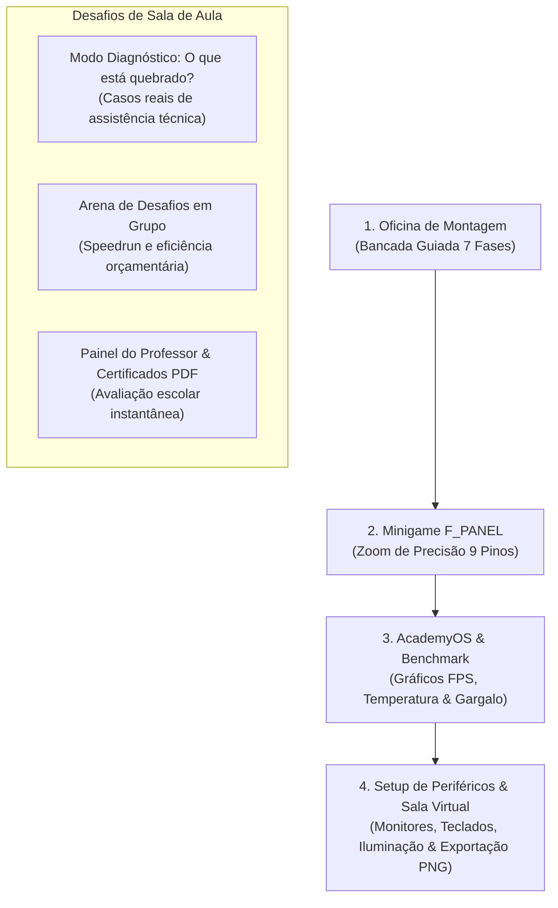

# PRD v2.0 — Plataforma Educativa "PC Builder Academy"
### Jogo Educativo e Interativo de Montagem, Diagnóstico, Setup Completo e Sala Virtual

---

## 1. Visão Geral do Produto (v2.0)

### 1.1 Objetivo
O **PC Builder Academy** evolui de um simulador de bancada de hardware para uma **plataforma completa de vivência do ecossistema de computadores**. Além de aprender a montagem canônica e as regras de compatibilidade física, os estudantes do **1º Ano do Ensino Médio**:
1. Diagnosticam e consertam computadores com defeito (**Modo Detetive de Hardware**).
2. Dominam a conexão minuciosa do painel frontal (**Minigame Zoom `F_PANEL`**).
3. Experimentam o computador ligado após a BIOS instalando o **AcademyOS**, rodando testes de estresse, gráficos de telemetria e **benchmarks de jogos com medição real de gargalo (bottleneck)**.
4. Escolhem o **Setup Completo de Periféricos** (Monitores com diferentes taxas de atualização, Teclados mecânicos de diferentes switches, Mouses gamers, Suportes articulados e Gamepads).
5. Posicionam seu computador em uma **Sala Virtual Personalizada** (Quarto Gamer LED, Estúdio Clean Minimalista, Sala de Aula Tech) e exportam uma **foto em alta definição (PNG)** do seu setup dos sonhos para levar para casa ou compartilhar com a turma.
6. Permitem ao professor emitir **Certificados Oficiais em PDF** e projetar um **Leaderboard da Turma** em tempo real.

---

## 2. Jornada do Aluno e Modos de Jogo (v2.0)

---

## 3. Detalhamento dos Novos Módulos

### Módulo 1: Modo Diagnóstico — "O que está quebrado?" (Detetive de Hardware)
* **Objetivo:** Desenvolver o raciocínio investigativo de suporte técnico e manutenção preventiva.
* **Mecânica:** O aluno assume uma bancada de manutenção com um computador que apresenta um sintoma de erro. Ele deve inspecionar a máquina, usar os Debug LEDs, observar a fonte e os cabos, e consertar o problema:
  * **Caso 1 (Morte Aparente):** O PC não liga nada. *Causa:* Chave I/O traseira da fonte desligada ou conector `POWER SW` invertido no pino cego.
  * **Caso 2 (Desarme Térmico):** Liga, ventoinha gira rápido e desliga em 4 segundos com LED de CPU vermelho. *Causa:* Cooler assentado sem pasta térmica ou com a película plástica de fábrica não removida.
  * **Caso 3 (Sem Vídeo & 3 Bips):** PC liga, coolers giram, mas o monitor fica preto com LED de DRAM vermelho. *Causa:* Pente de memória mal assentado ou colocado em slot incorreto.
  * **Caso 4 (O Clássico Erro de Monitor):** PC liga com sucesso, mas o monitor avisa "Sem Sinal". *Causa:* O cabo HDMI foi plugado na saída de vídeo da placa-mãe em vez de na placa de vídeo dedicada!
  * **Caso 5 (Curto-Circuito Intermitente):** PC desarma assim que encosta no botão power. *Causa:* Falta de espaçadores de latão (standoffs) ou parafuso solto atrás da placa.

### Módulo 2: Minigame de Zoom do Painel Frontal (`F_PANEL`)
* **Objetivo:** Desmistificar a conexão mais temida e propensa a erros por técnicos iniciantes.
* **Mecânica:**
  * O jogo ativa uma visualização em zoom macro (300%) do cabeçalho de 9 pinos `F_PANEL` da placa-mãe.
  * O aluno arrasta os conectores individuais:
    * `POWER SW` (2 pinos, preto e vermelho, momentâneo — sem polaridade obrigatória).
    * `RESET SW` (2 pinos, azul e branco — sem polaridade obrigatória).
    * `HDD LED` (2 pinos, vermelho [+] e preto [-] — polaridade estrita!).
    * `POWER LED` (2 pinos individuais separados ou bloco de 2 pinos, verde [+] e preto [-]).
  * O minigame dá feedback imediato: se inverter o LED, ele avisa *"O LED é um diodo e só conduz eletricidade em um sentido; inverta a posição dos pinos +"*.

### Módulo 3: AcademyOS, Telemetria & Benchmark de Jogos
* **Objetivo:** Demonstrar a consequência direta das escolhas de hardware no software real.
* **Mecânica:**
  * Após o POST bem-sucedido na BIOS, o aluno clica em *"Carregar AcademyOS"*.
  * O simulador abre um ambiente de desktop gráfico estilizado com 3 utilitários:
    1. **Monitor de Telemetria:** Gráficos em tempo real com curva de temperatura da CPU (°C), frequência de clock (GHz), uso de VRAM da placa de vídeo e consumo elétrico total (Watts).
    2. **CyberRacer 2026 (Benchmark de Jogo):** Simulação de um jogo 3D rodando em tempo real:
       * Exibe média de FPS (ex: 144 FPS em 1080p, 90 FPS em 1440p, 45 FPS em 4K).
       * Exibe o tempo de quadro (*frametime* em ms) e estabilidade de 1% low.
    3. **Medidor de Gargalo (*Bottleneck Meter*):**
       * Analisa se a CPU limita a GPU ou vice-versa (ex: *Ryzen 5 5600 + RTX 4070 Super em 1080p gera 28% de gargalo de CPU*).
       * Explica didaticamente ao aluno: *"Seu processador não consegue preparar os quadros na mesma velocidade que a placa de vídeo desenha. Para resolver isso, aumente a resolução para 1440p ou faça upgrade de CPU."*

### Módulo 4: Setup de Periféricos & Acessórios
* **Objetivo:** Ensinar a ergonomia e compatibilidade dos periféricos com o computador montado.
* **Componentes Selecionáveis:**
  * **Monitores:**
    * Monitor Office 24" 1080p 75Hz Painel IPS.
    * Monitor Gamer 27" 1080p 165Hz 1ms FreeSync.
    * Monitor Curvo 34" Ultrawide 1440p 144Hz.
    * Monitor Profissional 27" 4K 144Hz HDR600.
  * **Teclados:**
    * Teclado Membrana ABNT2 Silencioso de Escritório.
    * Teclado Mecânico TKL Switch Red (Linear e Silencioso).
    * Teclado Mecânico 60% Switch Blue (Tátil com clique sonoro audível).
  * **Mouses & Mousepads:**
    * Mouse Ergonômico Vertical de Escritório.
    * Mouse Gamer Ultraleve 65g com sensor óptico PixArt 3395.
    * Mousepad Estendido Speed (900x400mm) com costura reforçada.
  * **Áudio & Ergonomia:**
    * Headset Gamer 7.1 com microfone antirruído.
    * Caixas de Som Estéreo de Mesa em Madeira.
    * Suporte Articulado a Gás para 1 ou 2 monitores (libera espaço na mesa).
    * Gamepad sem fio com gatilhos magnéticos Hall Effect.

### Módulo 5: A Sala Virtual do Aluno & Exportador de Imagem (PNG)
* **Objetivo:** Sentimento de realização e posse do próprio projeto. O aluno vê o seu PC e periféricos integrados em um quarto real e pode exportar a foto.
* **Ambientes Selecionáveis:**
  1. **Quarto Gamer RGB:** Iluminação ambiente neon, prateleiras com colecionáveis, fita de LED atrás da mesa.
  2. **Escritório Minimalista Clean:** Madeira clara, plantas, luz natural, estilo estúdio de arquitetura/design.
  3. **Laboratório Escolar Tech:** Bancada de engenharia com ferramentas, osciloscópio e banners educativos.
  4. **Quarto Retrô / Vaporwave:** Tons roxos e ciano com estética anos 90/2000.
* **Exportação da Imagem do Setup:**
  * Renderização instantânea no cliente via Canvas 2D em alta resolução (1920x1080).
  * O print inclui:
    * O computador montado no gabinete escolhido.
    * A mesa com os periféricos selecionados.
    * O ambiente de fundo escolhido.
    * Um selo com o nome do aluno/equipe, especificações da máquina (ex: *Core i5 / RTX 4060 / 16GB DDR5*) e pontuação alcançada.
  * Botão *"Baixar Imagem do Meu Setup (PNG)"* para salvar no computador da escola ou no celular.

### Módulo 6: Painel do Professor & Certificados Escolares em PDF
* **Objetivo:** Facilitar a avaliação formal do professor de informática/tecnologia na escola.
* **Funcionalidades:**
  * **Projetor de Sala (Leaderboard):** O professor digita o código gerado pelo computador de cada equipe (ex: `PCA-X7K9P2`) e a tela atualiza o placar com tempo, custo e notas.
  * **Emissor de Certificado em PDF:** Gera um documento padronizado pronto para impressão ou envio por e-mail com:
    * Nome da Escola, Turma e Nomes dos Alunos.
    * Habilidades Validadas: Segurança Eletrostática, Compatibilidade de Soquetes, Balanceamento de TDP e Diagnóstico de Falhas.
    * Assinatura do Professor e código de autenticidade criptográfico.

---

## 4. Requisitos Não Funcionais (v2.0)

* **RNF05 (Processamento 100% Client-Side):** A geração de imagens PNG e simulação de benchmark não utiliza servidores de renderização caros; tudo é renderizado localmente no navegador via Canvas/SVG e Framer Motion.
* **RNF06 (Suporte a PWA):** O jogo pode ser instalado como aplicativo de desktop na sala de informática, funcionando mesmo que a conexão de internet da escola caia.
