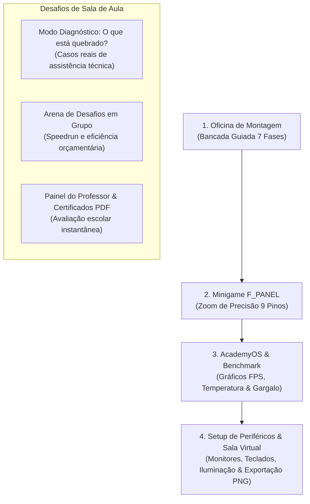

# PRD v2.1 — Plataforma Educativa "PC Builder Academy"
### Jogo Educativo e Interativo de Montagem, Diagnóstico, Setup Completo e Sala Virtual

> **Histórico de versões**
> * **v2.0** — Diagnóstico, F_PANEL, AcademyOS, periféricos, sala virtual, painel do professor e PWA.
> * **v2.1** — Revisão técnica e pedagógica das regras (TDD), ilustrações orientadas por dados, minigame F_PANEL com arrastar e soltar, cabeamento completo da placa-mãe e roadmap de visualização 3D (seções 5 a 8).

---

## 1. Visão Geral do Produto (v2.0)

### 1.1 Objetivo
O **PC Builder Academy** evolui de um simulador de bancada de hardware para uma **plataforma completa de vivência do ecossistema de computadores**. Além de aprender a montagem canônica e as regras de compatibilidade física, os estudantes do **1º Ano do Ensino Médio**:
1. Diagnosticam e consertam computadores com defeito (**Modo Detetive de Hardware**).
2. Dominam a conexão minuciosa do painel frontal (**Minigame Zoom `F_PANEL`**).
3. Experimentam o computador ligado após a BIOS instalando o **AcademyOS**, rodando testes de estresse, gráficos de telemetria e **benchmarks de jogos com medição real de gargalo (bottleneck)**.
4. Escolhem o **Setup Completo de Periféricos** (Monitores com diferentes taxas de atualização, Teclados mecânicos de diferentes switches, Mouses gamers, Suportes articulados e Gamepads).
5. Posicionam seu computador em uma **Sala Virtual Personalizada** (Quarto Gamer LED, Estúdio Clean Minimalista, Sala de Aula Tech) e exportam uma **foto em alta definição (PNG)** do seu setup dos sonhos para levar para casa ou compartilhar com a turma.
6. Permitem ao professor emitir **Certificados Oficiais em PDF** e projetar um **Leaderboard da Turma** em tempo real.

---

## 2. Jornada do Aluno e Modos de Jogo (v2.0)

---

## 3. Detalhamento dos Novos Módulos

### Módulo 1: Modo Diagnóstico — "O que está quebrado?" (Detetive de Hardware)
* **Objetivo:** Desenvolver o raciocínio investigativo de suporte técnico e manutenção preventiva.
* **Mecânica:** O aluno assume uma bancada de manutenção com um computador que apresenta um sintoma de erro. Ele deve inspecionar a máquina, usar os Debug LEDs, observar a fonte e os cabos, e consertar o problema:
  * **Caso 1 (Morte Aparente):** O PC não liga nada. *Causa:* Chave I/O traseira da fonte desligada ou conector `POWER SW` invertido no pino cego.
  * **Caso 2 (Desarme Térmico):** Liga, ventoinha gira rápido e desliga em 4 segundos com LED de CPU vermelho. *Causa:* Cooler assentado sem pasta térmica ou com a película plástica de fábrica não removida.
  * **Caso 3 (Sem Vídeo & 3 Bips):** PC liga, coolers giram, mas o monitor fica preto com LED de DRAM vermelho. *Causa:* Pente de memória mal assentado ou colocado em slot incorreto.
  * **Caso 4 (O Clássico Erro de Monitor):** PC liga com sucesso, mas o monitor avisa "Sem Sinal". *Causa:* O cabo HDMI foi plugado na saída de vídeo da placa-mãe em vez de na placa de vídeo dedicada!
  * **Caso 5 (Curto-Circuito Intermitente):** PC desarma assim que encosta no botão power. *Causa:* Falta de espaçadores de latão (standoffs) ou parafuso solto atrás da placa.

### Módulo 2: Minigame de Zoom do Painel Frontal (`F_PANEL`)
* **Objetivo:** Desmistificar a conexão mais temida e propensa a erros por técnicos iniciantes.
* **Mecânica:**
  * O jogo ativa uma visualização em zoom macro (300%) do cabeçalho de 9 pinos `F_PANEL` da placa-mãe.
  * O aluno arrasta os conectores individuais:
    * `POWER SW` (2 pinos, preto e vermelho, momentâneo — sem polaridade obrigatória).
    * `RESET SW` (2 pinos, azul e branco — sem polaridade obrigatória).
    * `HDD LED` (2 pinos, vermelho [+] e preto [-] — polaridade estrita!).
    * `POWER LED` (2 pinos individuais separados ou bloco de 2 pinos, verde [+] e preto [-]).
  * O minigame dá feedback imediato: se inverter o LED, ele avisa *"O LED é um diodo e só conduz eletricidade em um sentido; inverta a posição dos pinos +"*.

### Módulo 3: AcademyOS, Telemetria & Benchmark de Jogos
* **Objetivo:** Demonstrar a consequência direta das escolhas de hardware no software real.
* **Mecânica:**
  * Após o POST bem-sucedido na BIOS, o aluno clica em *"Carregar AcademyOS"*.
  * O simulador abre um ambiente de desktop gráfico estilizado com 3 utilitários:
    1. **Monitor de Telemetria:** Gráficos em tempo real com curva de temperatura da CPU (°C), frequência de clock (GHz), uso de VRAM da placa de vídeo e consumo elétrico total (Watts).
    2. **CyberRacer 2026 (Benchmark de Jogo):** Simulação de um jogo 3D rodando em tempo real:
       * Exibe média de FPS (ex: 144 FPS em 1080p, 90 FPS em 1440p, 45 FPS em 4K).
       * Exibe o tempo de quadro (*frametime* em ms) e estabilidade de 1% low.
    3. **Medidor de Gargalo (*Bottleneck Meter*):**
       * Analisa se a CPU limita a GPU ou vice-versa (ex: *Ryzen 5 5600 + RTX 4070 Super em 1080p gera 28% de gargalo de CPU*).
       * Explica didaticamente ao aluno: *"Seu processador não consegue preparar os quadros na mesma velocidade que a placa de vídeo desenha. Para resolver isso, aumente a resolução para 1440p ou faça upgrade de CPU."*

### Módulo 4: Setup de Periféricos & Acessórios
* **Objetivo:** Ensinar a ergonomia e compatibilidade dos periféricos com o computador montado.
* **Componentes Selecionáveis:**
  * **Monitores:**
    * Monitor Office 24" 1080p 75Hz Painel IPS.
    * Monitor Gamer 27" 1080p 165Hz 1ms FreeSync.
    * Monitor Curvo 34" Ultrawide 1440p 144Hz.
    * Monitor Profissional 27" 4K 144Hz HDR600.
  * **Teclados:**
    * Teclado Membrana ABNT2 Silencioso de Escritório.
    * Teclado Mecânico TKL Switch Red (Linear e Silencioso).
    * Teclado Mecânico 60% Switch Blue (Tátil com clique sonoro audível).
  * **Mouses & Mousepads:**
    * Mouse Ergonômico Vertical de Escritório.
    * Mouse Gamer Ultraleve 65g com sensor óptico PixArt 3395.
    * Mousepad Estendido Speed (900x400mm) com costura reforçada.
  * **Áudio & Ergonomia:**
    * Headset Gamer 7.1 com microfone antirruído.
    * Caixas de Som Estéreo de Mesa em Madeira.
    * Suporte Articulado a Gás para 1 ou 2 monitores (libera espaço na mesa).
    * Gamepad sem fio com gatilhos magnéticos Hall Effect.

### Módulo 5: A Sala Virtual do Aluno & Exportador de Imagem (PNG)
* **Objetivo:** Sentimento de realização e posse do próprio projeto. O aluno vê o seu PC e periféricos integrados em um quarto real e pode exportar a foto.
* **Ambientes Selecionáveis:**
  1. **Quarto Gamer RGB:** Iluminação ambiente neon, prateleiras com colecionáveis, fita de LED atrás da mesa.
  2. **Escritório Minimalista Clean:** Madeira clara, plantas, luz natural, estilo estúdio de arquitetura/design.
  3. **Laboratório Escolar Tech:** Bancada de engenharia com ferramentas, osciloscópio e banners educativos.
  4. **Quarto Retrô / Vaporwave:** Tons roxos e ciano com estética anos 90/2000.
* **Exportação da Imagem do Setup:**
  * Renderização instantânea no cliente via Canvas 2D em alta resolução (1920x1080).
  * O print inclui:
    * O computador montado no gabinete escolhido.
    * A mesa com os periféricos selecionados.
    * O ambiente de fundo escolhido.
    * Um selo com o nome do aluno/equipe, especificações da máquina (ex: *Core i5 / RTX 4060 / 16GB DDR5*) e pontuação alcançada.
  * Botão *"Baixar Imagem do Meu Setup (PNG)"* para salvar no computador da escola ou no celular.

### Módulo 6: Painel do Professor & Certificados Escolares em PDF
* **Objetivo:** Facilitar a avaliação formal do professor de informática/tecnologia na escola.
* **Funcionalidades:**
  * **Projetor de Sala (Leaderboard):** O professor digita o código gerado pelo computador de cada equipe (ex: `PCA-X7K9P2`) e a tela atualiza o placar com tempo, custo e notas.
  * **Emissor de Certificado em PDF:** Gera um documento padronizado pronto para impressão ou envio por e-mail com:
    * Nome da Escola, Turma e Nomes dos Alunos.
    * Habilidades Validadas: Segurança Eletrostática, Compatibilidade de Soquetes, Balanceamento de TDP e Diagnóstico de Falhas.
    * Assinatura do Professor e código de autenticidade criptográfico.

---

## 4. Requisitos Não Funcionais (v2.0)

* **RNF05 (Processamento 100% Client-Side):** A geração de imagens PNG e simulação de benchmark não utiliza servidores de renderização caros; tudo é renderizado localmente no navegador via Canvas/SVG e Framer Motion.
* **RNF06 (Suporte a PWA):** O jogo pode ser instalado como aplicativo de desktop na sala de informática, funcionando mesmo que a conexão de internet da escola caia.
* **RNF07 (Desempenho em PCs escolares):** 60 FPS em resoluções de 1366x768 a 1080p com vídeo integrado. Componentes só re-renderizam quando a parte do estado que exibem muda (seletores do Zustand); o relógio não pode redesenhar a página inteira.
* **RNF08 (Orçamento de JavaScript):** Primeira carga da página principal até ~210 kB. Recursos pesados (ex: visualização 3D) carregam sob demanda, apenas quando o aluno os abre.
* **RNF09 (Acessibilidade WCAG 2.2 AA):** Toda ação de arrastar tem alternativa por clique e por teclado; áreas de toque de no mínimo 44x44 px; animações respeitam `prefers-reduced-motion`; o zoom do navegador nunca é bloqueado.
* **RNF10 (Ativos de terceiros):** Só entram no jogo ativos com licença que permita uso e modificação (ex: CC-BY), com crédito visível ao autor. Ativos sem licença ou não baixáveis são proibidos, mesmo que estejam publicamente visíveis.

---

## 5. Revisão v2.1 — Regras de Montagem e Conteúdo Técnico (entregue)

A revisão completa do jogo apontou regras que existiam no catálogo mas nunca eram verificadas, além de erros de conteúdo técnico. Todas as correções foram feitas com testes escritos antes da implementação (TDD). Decisões técnicas: [ADR-008](./adr/ADR-008-fases-derivadas-e-regras-de-montagem.md).

### 5.1 Correções de conteúdo (#19)
* **Pinagem do F_PANEL no padrão Intel:** HDD LED nos pinos 1(+)/3(−), Power LED em 2(+)/4(−), Reset em 5/7, Power SW em 6/8, pino 9 reservado (NC) e pino 10 ausente (chave guia). A versão anterior ensinava a pinagem invertida.
* **Armazenamento:** HD mecânico classificado como `SATA_HDD` (antes aparecia como "SSD"). SSD NVMe vai no slot M.2 da placa; SSD SATA e HD vão na baia SATA do gabinete, com cabos.
* **Fonte genérica "Sem Selo"** deixou de aparecer como 80 Plus White.

### 5.2 Novas regras de montagem
| Regra | Comportamento |
| :--- | :--- |
| Descarga eletrostática (ESD) | Placa-mãe, CPU, RAM, GPU e disco ficam bloqueados até o aluno descarregar a estática (conta como erro). |
| Cooler | Soquete sem suporte é recusado (novo cooler Intel Laminar RM1, só LGA1700). Cooler fraco para o TDP da CPU encaixa, mas gera alerta e afeta o benchmark. |
| Pasta térmica | Não pode ser aplicada com o cooler instalado. Remover o cooler rompe a camada antiga e exige pasta nova. |
| Gabinete | Agora é peça do jogo: confere o formato da placa (ATX/Micro-ATX) e o comprimento máximo da GPU. Ligar sem gabinete (teste em bancada) continua permitido. |
| Fonte × GPU | Alerta quando a fonte está abaixo da potência recomendada pelo fabricante da placa de vídeo. |
| Fases da montagem | Calculadas a partir do estado físico da bancada (`derivePhase`), em vez de avançar manualmente. A régua do HUD mostra as fases concluídas. |
| Custo | Placa-mãe e gabinete entram no total gasto da missão. |

**Política de penalidade:** só conta como erro a ação que forçaria ou danificaria uma peça (soquete errado, memória de outra geração, cooler incompatível, falta de ESD, encaixe perigoso de cabo). Erros de ordem (ex: pasta com o cooler instalado) são recusados com explicação, sem penalidade.

### 5.3 Visual dos componentes (#20)
Decisões técnicas: [ADR-009](./adr/ADR-009-ilustracoes-orientadas-por-dados.md).
* **Ilustrações orientadas por dados:** cada desenho vem dos dados do catálogo (GPU em escala real com régua em mm, número de pentes do kit, selo 80 Plus na cor da certificação, ATX maior que Micro-ATX, cooler box/torre/AIO, RGB só em peças RGB).
* **Selo de compatibilidade no card:** frase curta dizendo se a peça combina com a bancada atual ("Placa usa DDR5", "GPU de 295mm não cabe", "Folga de 210W") e faixa de preço (Entrada, Intermediário, Topo de linha).
* **Peças instaladas desenhadas na placa** com a mesma ilustração do inventário.
* Fontes Space Grotesk e JetBrains Mono embutidas no build (funcionam offline).

### 5.4 Minigame F_PANEL com arrastar e soltar (#21)
* O aluno arrasta cada conector do gabinete até o cabeçalho de 9 pinos; perto de um par livre, o conector é atraído e aparece uma prévia.
* Os LEDs começam em orientação aleatória: é preciso ler o "+" da serigrafia e girar o conector (botão ou tecla R).
* Encaixe errado faz o conector tremer, voltar para a bandeja e explicar o motivo.
* Alternativas: clicar no conector e depois no pino; navegação por teclado.

### 5.5 Cabeamento completo da placa-mãe (#22)
Decisões técnicas: [ADR-010](./adr/ADR-010-cabeamento-e-arrastar-e-soltar.md).
* **Placa detalhada:** I/O traseiro, bobinas das fases, bateria CMOS, chipset, chip de áudio e chip da BIOS.
* **Conectores reais como alvos:** ATX_PWR (24 pinos), ATX12V (8 pinos da CPU), CPU_FAN, SYS_FAN, USB 3.0 (19 pinos), USB 2.0, HD_AUDIO, portas SATA, F_PANEL, entrada PCIe na própria GPU e entrada de energia do disco na baia SATA.
* **Bandeja de cabos** em três grupos (fonte, gabinete e peças); cada cabo só aparece quando a peça de onde sai está instalada.
* **Erros clássicos explicados:** EPS × PCIe de 8 pinos (perigoso, conta como erro), HD_AUDIO no USB 2.0 (chaves diferentes), ventoinha do cooler no SYS_FAN ("CPU Fan Error"), energia SATA na porta de dados.
* O POST passa a avisar sobre ventoinhas do gabinete desligadas e dá dicas sobre USB e áudio frontais sem cabo.

---

## 6. Módulo 7 — Visualização 3D (Roadmap v3.0)

### 6.1 Objetivo
Permitir que o aluno veja e manipule as peças em 3D (girar, aproximar, ver por baixo) para reconhecer os formatos reais, sem perder a leveza, o funcionamento offline e a acessibilidade da versão 2D. Decisão técnica: [ADR-011](./adr/ADR-011-visualizacao-3d-hibrida.md).

### 6.2 Fontes de modelos (#35)
Modelos da coleção do Sketchfab indicada para o projeto, filtrados por licença e peso (consulta à API pública em 02/11/2026):

| Peça | Modelo | Licença | Faces | Uso |
| :--- | :--- | :--- | ---: | :--- |
| Memória RAM | Crucial 8 GB DDR4 2133 | CC-BY | 2.428 | Fase 1 |
| SSD NVMe | Samsung 980 Pro NVMe 1TB | CC-BY | 1.392 | Fase 1 |
| SSD SATA | Samsung SSD 2.5in | CC-BY | 918 | Fase 1 |
| CPU | Intel CPU | CC-BY | 368 | Fase 1 |
| GPU | GPU AMD RX 6700 XT | CC-BY | 7.620 | Fase 1 |
| GPU | PowerColor RX 570 | CC-BY | 7.552 | Fase 1 |
| HD | Hard Drive | CC-BY-SA | 5.131 | Fase 1 |
| Placa-mãe (leve) | Motherboard (user12350) | CC-BY | 10.056 | Fase 1 |
| Placa-mãe Micro-ATX | ASUS Prime H510M-K | CC-BY | 406.136 | Fase 2 (reduzir para ~60 mil) |
| Placa-mãe ATX | MAXIMUS VI Formula | CC-BY | 61.092 | Fase 2 |

**Não utilizáveis:** "Motherboard mATX" e "RTX 4070" (digitalrazor3d) e "Rebuild ASUS X299 SAGE" não podem ser baixados e não têm licença; o monitor Samsung tem licença Standard paga; as GeForce RTX 20xx são CC-BY-NC (não comercial) e pesadas (350 a 400 mil faces); a Strix B550-F tem 818 mil faces.

### 6.3 Fases
1. **Fase 1 — Visualizador 3D das peças (#36):** na ficha didática do card, o aluno gira e aproxima a peça. Carregado sob demanda; se o computador não suportar WebGL, a ilustração 2D continua aparecendo.
2. **Fase 2 — Bancada 3D (#37):** placa-mãe em 3D com câmera de cima para montar e cabear. Slots e conectores são marcados como pontos âncora no modelo e projetados na tela como os mesmos alvos usados hoje, reaproveitando regras, arrastar e soltar, clique e teclado.
3. **Fase 3 — Polimento (#38):** animação de encaixe em 3D, vista explodida e ventoinhas girando no teste de boot.

### 6.4 Requisitos
* Cena com no máximo ~200 mil faces no total; cada modelo otimizado com até ~2 MB (geometria comprimida e texturas de até 1024 px).
* three.js e React Three Fiber carregados sob demanda (não entram na primeira carga — RNF08).
* Modelos guardados no cache do PWA para funcionar offline (depende da correção do service worker).
* Tela "Créditos 3D" com autor, link e licença de cada modelo (RNF10).
* Giro automático desligado com `prefers-reduced-motion`; controles de câmera também por teclado.
* A versão 2D permanece como "modo leve" para PCs fracos e navegadores sem WebGL.
* O download dos modelos exige login no Sketchfab e é feito por uma pessoa da equipe.

---

## 7. Backlog de Melhorias (identificado na revisão v2.1)

| Área | Item | Prioridade |
| :--- | :--- | :--- |
| PWA | O service worker usa cache-first para o HTML e serve versões antigas após cada deploy (causa erro de hidratação). Trocar por network-first na navegação. (#24) | Alta (bloqueia o 3D offline) |
| Integração | A `main` recebeu a expansão do catálogo (+70 peças, #18); integrar com as ilustrações por dados, selos e cabeamento desta versão. (#23) | Alta |
| Pontuação | Kit de 2 pentes de RAM é cobrado duas vezes ao ocupar os slots 2 e 4. (#25) | Alta |
| Missões | Os requisitos do cliente (RAM, armazenamento, GPU, benchmark) aparecem, mas não são avaliados; falta a tela de entrega ao cliente. (#27) | Alta |
| Acessibilidade | `maximumScale: 1` bloqueia o zoom; animações `bounce`/`pulse` ignoram movimento reduzido; não há botão de mudo; controles restantes sem `aria`. (#28) | Alta |
| Pontuação | O score usa `GPU instalada ? 2000 : 800` em vez do motor de benchmark. (#26) | Média |
| Professor | O código de validação é aleatório e o validador só confere o formato; o leaderboard some ao fechar o modal. (#29) | Média |
| Progresso | Nada é salvo: um F5 apaga a montagem e as conquistas. (#30) | Média |
| Desempenho | Vários componentes ainda leem o store inteiro e redesenham a cada segundo do relógio. (#31) | Média |
| Diagnóstico | O checklist sempre visível entrega a resposta; falta etapa de hipótese, pontuação por tentativas e casos sorteados. (#32) | Média |
| Qualidade | ESLint não configurado; faltam testes E2E dos fluxos de arrastar e soltar. (#33) | Média |
| Professor | Relatório dos erros mais comuns da turma, exportação CSV e mapeamento BNCC. (#34) | Baixa |

---

## 8. Rastreabilidade
Cada item das seções 5 a 7 tem uma issue no GitHub. A lista completa está em [docs/README.md](./README.md#-issues-da-v21-e-v30).
