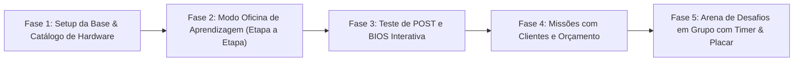

# 🛠️ PC Builder Academy — Documentação de Engenharia e Design

Bem-vindo à documentação oficial do **PC Builder Academy**, o jogo educativo, interativo e gamificado de montagem de computadores projetado para alunos do **1º Ano do Ensino Médio**.

Esta pasta contém todo o planejamento conceitual, arquitetural e visual do projeto.

---

## 📚 Mapa da Documentação

| Documento | Descrição e Conteúdo |
| :--- | :--- |
| 📄 **[PRD (Product Requirements Document)](./PRD.md)** | Visão geral pedagógica, personas (aluno e professor), jornadas dos 3 modos de jogo, detalhamento completo das 7 fases da montagem canônica, requisitos funcionais e métricas de sucesso escolar. |
| 🎨 **[Design System](./design-system.md)** | Identidade visual (Cyber-Industrial & Clean Tech), paleta de cores para bancada e LEDs de status, tipografia, design de áudio sintetizado, anatomia de componentes visuais (cards, slots, assistente didático e BIOS). |
| 🏛️ **[ADRs (Architecture Decision Records)](./adr/)** | Decisões técnicas fundamentadas para o desenvolvimento da plataforma. |

---

## 🏛️ Registros de Decisões de Arquitetura (ADRs)

* **[ADR-001: Seleção de Stack e Plataforma Web](./adr/ADR-001-stack-e-plataforma-web.md)**
  * Adoção de Next.js 15+ (App Router), React 19, TypeScript e Tailwind CSS para garantir acessibilidade universal sem necessidade de instalação em computadores escolares.
* **[ADR-002: Motor de Interatividade, Estado de Montagem e Animações](./adr/ADR-002-motor-de-interatividade-e-montagem.md)**
  * Uso de Zustand para gerenciamento reativo do estado da montagem, Máquina de Estados Finita (FSM) para validação da ordem das etapas e Framer Motion para drag-and-drop com encaixe magnético e clique-para-posicionar.
* **[ADR-003: Motor de Regras de Hardware e Validação](./adr/ADR-003-regras-de-hardware-e-validacao.md)**
  * Modelagem tipada de peças reais (soquetes, chipsets, gerações de memória DDR4/DDR5, dissipação térmica, potência de fonte e folga) com feedback didático em vez de erros crípticos.
* **[ADR-004: Sistema de Áudio Procedural e Feedback Multimodal](./adr/ADR-004-sistema-de-audio-e-feedback-multimodal.md)**
  * Geração dos sons mecânicos e bips clássicos da BIOS via Web Audio API (zero megabytes de download para a escola) com sincronização visual completa para acessibilidade.
* **[ADR-005: Gamificação, Desafio em Grupos e Dinâmica de Sala](./adr/ADR-005-gamificacao-e-desafio-em-grupos.md)**
  * Sistema de pontuação balanceado (tempo, precisão da montagem, equilíbrio de peças e orçamento) com entrada simplificada por equipes sem necessidade de login complexo.

---

## 🚀 Fases de Implementação Recomendadas

