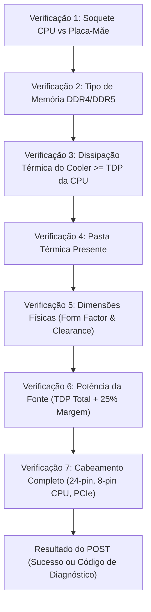

# ADR-003: Motor de Regras de Hardware e Validação de Compatibilidade

## Status
Aprovado. **Ampliado na v2.1:** novas regras de cooler, armazenamento, gabinete, ESD, pasta térmica e fonte × GPU, com política de penalidade ([ADR-008](./ADR-008-fases-derivadas-e-regras-de-montagem.md)), e regras de cabeamento ([ADR-010](./ADR-010-cabeamento-e-arrastar-e-soltar.md)).

## Contexto
O coração educativo do simulador é ensinar o funcionamento técnico das peças de um computador e por que determinadas peças funcionam juntas e outras não. No mundo real, a montagem incorreta de peças incompatíveis pode resultar em danos físicos irreversíveis (como pinos tortos no soquete da CPU, slots de memória quebrados ou queima da fonte de alimentação).

Precisamos de um **Motor de Regras (Rules Engine)** desacoplado da interface gráfica, determinístico, testável e capaz de fornecer diagnósticos claros e explicativos para o aluno.

## Decisão
Implementamos um subsistema dedicado em TypeScript (`src/engine/validation/`) composto por pipelines de verificação pura:

### 1. Modelo de Tipos Estritos de Hardware
Cada peça possui atributos técnicos canônicos:
* **CPU:** `socket` (ex: `LGA1700`, `AM5`), `tdpWatts`, `integratedGpu` (boolean), `supportedRamTypes` (`['DDR4', 'DDR5']`), `architectureCores`, `threads`.
* **Motherboard:** `socket`, `chipset`, `formFactor` (`ATX`, `Micro-ATX`, `Mini-ITX`), `ramType` (`DDR4` ou `DDR5`), `ramSlotsCount`, `pcieSlotsCount`, `m2SlotsCount`, `sataPortsCount`, `integratedIoShield` (boolean).
* **RAM:** `type` (`DDR4`, `DDR5`), `capacityGb`, `frequencyMhz`, `channelsCount`.
* **GPU:** `pcieVersion`, `vramGb`, `tdpWatts`, `lengthMm`, `requiredPsuWatts`, `powerConnectors` (`['8pin', '6pin']`).
* **PSU:** `ratedWatts`, `efficiencyRating` (`None`, `80Plus_Bronze`, `80Plus_Gold`), `pcieConnectorsCount`, `epsConnectorsCount`.
* **Cooler:** `supportedSockets`, `maxTdpDissipationWatts`, `coolerType` (`AirCooler`, `AIO_Liquid`).
* **Case (Gabinete):** `supportedFormFactors`, `maxGpuLengthMm`, `maxCoolerHeightMm`, `preinstalledStandoffs` (boolean).

### 2. Pipeline de Validação
O motor executa as seguintes verificações sempre que uma ação é tentada ou no momento do teste de boot:



### 3. Diagnósticos com Feedback Pedagógico
Em vez de retornar apenas um booleano `true`/`false`, o motor retorna objetos ricos de diagnóstico:
```typescript
interface DiagnosticFeedback {
  status: 'OPTIMAL' | 'WARNING' | 'CRITICAL_ERROR';
  code: string;
  title: string;
  explanation: string; // Linguagem acessível ao aluno
  technicalDetails: string; // Explicação com termos reais da engenharia
  remedyAction: string; // O que o aluno deve fazer para corrigir
}
```

## Consequências
* **Positivas:**
  * Facilita a criação de testes automatizados (unit tests) para cada regra de compatibilidade.
  * Permite adicionar novas peças e marcas facilmente apenas editando o arquivo de catálogo JSON/TypeScript.
  * Alimenta diretamente o sistema de dicas do assistente virtual e os relatórios de erros do professor.

