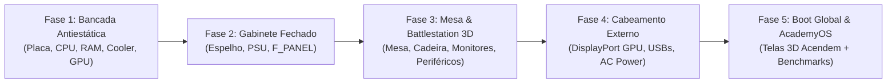

# 🖥️ Especificação Técnica & Plano de Implementação: Fase 4 — Mesa & Battlestation 3D

## 1. Visão Geral do Módulo
A **Fase 4 (Mesa & Battlestation 3D)** é a evolução natural do fluxo da oficina do **PC Builder Academy**. Após o aluno montar a placa-mãe na bancada antiestática e encapsulá-la no gabinete, ele avança para a etapa de **montagem do setup completo na mesa de trabalho**, conectando os periféricos físicos externos e presenciando o computador montado ligar seus monitores, periféricos e sistema operacional em tempo real.



---

## 2. Modelos 3D Já Integrados no Repositório (`public/models/`)
Todos os modelos 3D necessários já estão otimizados e disponíveis localmente com licenças permissivas conferidas em `docs/modelos-3d.md`:

| Categoria | Arquivo GLB | Função no Setup 3D |
| :--- | :--- | :--- |
| **Mobiliário** | `/models/mesa-gamer.glb` | Base da estação de trabalho com tampo de fibra de carbono e canaletas de cabo |
| **Mobiliário** | `/models/cadeira-escritorio.glb` | Cadeira ergonômica ajustada em frente à mesa |
| **Gabinete do Aluno** | `/models/case-corsair-4000d.glb` ou `/models/case-compacto.glb` | O PC que o próprio aluno montou na bancada, com sua placa e componentes dentro |
| **Monitores** | `/models/monitor-27-gamer.glb`, `/models/monitor-ultrawide.glb`, `/models/monitor-24-office.glb`, `/models/monitor-curvo-gamer.glb` | Tela(s) com suporte padrão ou braço articulado |
| **Suportes** | `/models/suporte-articulado.glb` | Braço a gás preso na borda da mesa para monitores flutuantes |
| **Teclados** | `/models/teclado-mecanico.glb`, `/models/teclado-mecanico-custom.glb`, `/models/teclado-membrana.glb` | Teclado posicionado centralizado sobre o mousepad |
| **Mouses** | `/models/mouse-gamer.glb` e `/models/mousepad-gamer.glb` | Mousepad XL com iluminação de borda e mouse óptico |
| **Áudio** | `/models/headphone-estudio.glb` e `/models/headphone-bluetooth.glb` | Fone de estúdio descansando no suporte ou sobre a mesa |
| **Acessórios** | `/models/microfone-boom.glb`, `/models/webcam.glb`, `/models/stream-deck.glb`, `/models/volante-gamer.glb` | Adicionais opcionais para setups de streaming ou simulação |

---

## 3. Arquitetura da Máquina de Estados (`src/engine/deskSetup.ts`)

A máquina de estados desacoplada em TypeScript puro gerencia os pontos de fixação (*Snap Points*) na mesa:

```typescript
export type DeskSnapPointId =
  | 'DESK_SURFACE'       // A própria mesa no quarto/laboratório
  | 'PC_POSITION'        // Gabinete (lado direito da mesa ou suporte inferior)
  | 'MONITOR_CENTER'     // Monitor principal
  | 'MONITOR_SECONDARY'  // Monitor secundário ou braço duplo
  | 'MOUSEPAD_CENTER'    // Base para periféricos
  | 'KEYBOARD_POSITION'  // Centralizado sobre o mousepad
  | 'MOUSE_POSITION'     // Lado direito do mousepad
  | 'HEADSET_STAND'      // Suporte de headphone
  | 'CHAIR_POSITION';    // Em frente à mesa

export interface ExternalCableConnection {
  id: 'POWER_AC' | 'DISPLAY_GPU' | 'USB_KEYBOARD' | 'USB_MOUSE' | 'AUDIO_JACK';
  source: 'WALL_OUTLET' | 'MONITOR' | 'KEYBOARD' | 'MOUSE' | 'HEADSET';
  target: 'PSU_INLET' | 'GPU_DISPLAYPORT' | 'MB_USB_1' | 'MB_USB_2' | 'MB_AUDIO_OUT';
  isCorrect: boolean;
  connected: boolean;
}
```

### Regras Pedagógicas Críticas de Cabeamento Externo:
1. **O Erro Clássico do Cabo de Vídeo:** Se o aluno conectar o cabo DisplayPort/HDMI na saída de vídeo da **Placa-Mãe** quando o computador possui uma **GPU Dedicada**, o jogo emite um aviso didático:
   > *"Atenção! Você possui uma placa de vídeo dedicada instalada. O cabo de vídeo do monitor deve ser conectado diretamente nas saídas traseiras da GPU, e não na placa-mãe!"*
2. **Cabo de Força AC:** O computador só liga na mesa se o cabo de força tripolar estiver conectado na fonte e na tomada/filtro de linha.
3. **Periféricos USB:** Teclado e mouse devem ser plugados nas portas traseiras do espelho I/O da placa-mãe.

---

## 4. Renderização 3D e Telas Vivas dos Monitores

Os monitores no espaço 3D utilizam uma **CanvasTexture** dinâmica do Three.js:
- Quando o computador está desligado: o monitor exibe um painel preto fosco antirreflexo com LED indicador em standby (laranja).
- Ao acionar o botão Power do gabinete ou da régua:
  1. Sons procedurais de clique de chave de fonte e relé acionando via Web Audio API.
  2. Ventoinhas do gabinete e cooler começam a girar e iluminam o interior com LEDs ARGB.
  3. LED do monitor muda para ciano/verde.
  4. A tela do monitor 3D acende exibindo a animação de POST / Logo da placa-mãe e carrega o **AcademyOS Desktop** diretamente na superfície texturizada da tela 3D!

---

## 5. Divisão de Epics & Issues do GitHub

- **Issue 01:** Motor de Regras e Catálogo de Mobiliário/Periféricos Externos (`src/engine/deskSetup.ts`).
- **Issue 02:** Componente Three.js `DeskSetup3D` com Cena de Sala/Mesa e OrbitControls orbital amplo.
- **Issue 03:** Snap Points Interativos na Mesa com Iluminação e Hologramas de Encaixe.
- **Issue 04:** Sistema de Cabeamento Externo (DisplayPort para GPU, USBs e Força AC).
- **Issue 05:** CanvasTexture Viva para Monitores 3D com AcademyOS e Sincronização RGB.
- **Issue 06:** Testes Automatizados (Vitest TDD para regras de cabeamento externo + Playwright E2E).


---

## 6. Status de Implementação (03/11/2026)

| Issue | Status | Onde |
| :--- | :--- | :--- |
| 01 · Motor de regras da mesa | ✅ Concluída (revisada na auditoria) | `src/engine/deskSetup.ts` |
| 02 · Cena `DeskSetup3D` | ✅ Concluída | `src/components/three/DeskSetup3D.tsx`, `DeskStationScene.tsx` |
| 03 · Snap points com hologramas | ✅ Concluída | `evaluateDeskSnapPoints`, `buildDeskInventory`, `DeskInventoryPanel.tsx` |
| 04 · Cabeamento externo | ✅ Concluída | `externalCabling.ts`, `cableRouting.ts`, `DeskCablesLayer.tsx`, `DeskCablingPanel.tsx` |
| 05 · Tela viva do monitor | ✅ Concluída | `monitorScreen.ts`, `monitorCanvas.ts`, `MonitorView.tsx` |
| 06 · Testes automatizados | ✅ Concluída | Vitest (`deskLayout`, `cableRouting`, `monitorScreen`…) e Playwright (`deskPlacement`, `deskBootJourney`) |

**Decisões registradas:**
- Unidades em **metros** (1 unidade de mundo = 1 m); mesa de 140 × 60 cm (120 cm na versão de madeira), tampo a 75 cm.
- A mesa e o mousepad são **procedurais**: o GLB `mesa-gamer` tem periféricos embutidos e malhas fundidas pelo otimizador.
- O PC **liga** com o cabo de força na tomada mesmo com o vídeo errado — é assim que o aluno vê o **SEM SINAL**. O estágio `RUNNING` exige todo o cabeamento correto e o POST aprovado; mover o cabo de vídeo para a GPU com o PC ligado faz a imagem aparecer (hot-plug).
- A tela do monitor é uma `CanvasTexture` aplicada à malha da tela do GLB, com UVs planares geradas da própria geometria (funciona na tela curva do ultrawide).
