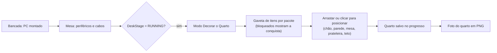

# 🛋️ Especificação Técnica & Plano de Implementação: Modo Decorar o Quarto

> Modelos candidatos: [modelos-3d-decoracao.md](./modelos-3d-decoracao.md) · dados: [modelos-3d-decoracao.json](./modelos-3d-decoracao.json).
> Relaciona-se com o [ADR-006](./adr/ADR-006-setup-completo-e-sala-virtual.md) (sala virtual e foto PNG), o [ADR-011](./adr/ADR-011-visualizacao-3d-hibrida.md) (3D sob demanda) e o [ADR-012](./adr/ADR-012-mesa-battlestation-e-cabeamento-externo.md) (mesa e estados `DeskStage`).
> Público: quem vai implementar. Regras novas do motor têm **teste antes da UI** (AGENTS.md).

## 1. Visão Geral

Quando o PC que o aluno montou **liga na mesa** (`DeskStage === 'RUNNING'`), abre-se o **Modo Decorar o Quarto**. O aluno transforma o laboratório num quarto próprio: móveis, iluminação, plantas e itens dos universos **gamer** e **nerd**. Ele posiciona tudo em 3D, por arrastar e soltar ou por clique, e tira uma foto do quarto.

A decoração também é **recompensa**. Os itens são liberados por conquistas pedagógicas (estrelas, diagnósticos resolvidos, perguntas de fixação, Modo Orçamento), e a vitrine expõe um troféu para cada missão com 3 estrelas.



---

## 2. Pacotes e Universos

| Pacote | Itens | Universo | Como libera |
| :--- | ---: | :--- | :--- |
| **Clássico** | 29 | Cama, estantes, plantas, luminárias, tapetes, quadros, objetos pessoais | Automático quando o PC liga na mesa pela primeira vez |
| **Gamer** | 19 | Fliperama, máquina de garra, TV de tubo, consoles retrô, arcade stick, óculos VR, cadeira gamer, neons, espuma acústica, frigobar, pelúcias, vitrine, troféu | Conquistas de montagem, desafio em equipe e mesa |
| **Nerd & Ciência** | 16 | Dados de RPG, xadrez, telescópio, capacete de astronauta, móbile de planetas, robôs, microscópio, Raspberry Pi, Arduino, drone, toca-discos, globo | Conquistas de diagnóstico, benchmark, perguntas de fixação e Modo Orçamento |
| **Museu do PC** | 4 | PC dos anos 90, terminal de mainframe, computadores antigos | Concluir a campanha (Prova Final, #57) |
| **Feitos por código** | — | Fita LED, painéis hexagonais, neon com texto, pôsteres com arte original | Fita LED e pôster: Clássico. Hexágonos e neon com texto: Gamer |

Regra de propriedade intelectual: **nenhum personagem, logotipo ou arte de franquia**. O "universo gamer e nerd" vem de objetos e referências genéricas (fliperama, dado d20, foguete, robô) e de arte original gerada pelo próprio jogo. Critérios completos em [modelos-3d-decoracao.md](./modelos-3d-decoracao.md#critérios-da-curadoria).

---

## 3. Arquitetura

```
src/engine/
├─ roomDecor.ts            catálogo de decoração (puro): DecorItem, zonas, pegadas, slots
├─ roomPlacement.ts        regras de posicionamento (puro): limites, colisão, zonas proibidas, encaixe
├─ decorUnlocks.ts         desbloqueios (puro): UnlockRule avaliada sobre PlayerProgress
├─ roomLayout.ts           geometria do quarto (puro): tamanho, paredes, janela, porta, mesa fixa
└─ models3d.data.json      + entradas com group "DECOR" (vindas de docs/modelos-3d-decoracao.json)
src/components/room3d/
├─ RoomShell.tsx           paredes, piso, janela e luz por tema (evolução do LaboratoryRoom)
├─ DecorScene.tsx          itens colocados (lazy, Suspense, instancing quando repetidos)
├─ DecorDrawer.tsx         gaveta de itens por pacote, bloqueados com a conquista exigida
├─ PlacementController.tsx arrastar, clicar para posicionar, teclado, fantasma verde/vermelho
├─ ProceduralDecor.tsx     fita LED, hexágonos, neon com texto, pôsteres por canvas
└─ RoomPhotoButton.tsx     foto do quarto em PNG
src/store/useRoomDecorStore.ts  estado do quarto, persistido e sanitizado
```

Tudo do Modo Decorar é carregado por `dynamic import` só quando o aluno abre o modo. A bancada não fica mais pesada.

### 3.1 Catálogo (`roomDecor.ts`)

```ts
export type DecorZone = 'FLOOR' | 'WALL' | 'DESK' | 'SHELF' | 'CEILING';
export type DecorPack = 'CLASSICO' | 'GAMER' | 'NERD' | 'MUSEU';

export interface DecorItem {
  id: string;                     // = id do modelo 3D (ex.: 'decor-fliperama') ou 'proc-*' para itens por código
  name: string;                   // pt-BR, exibido e lido pelo leitor de tela
  description: string;            // curiosidade didática curta (ex.: ano do Atari, o que é um Raspberry Pi)
  pack: DecorPack;
  zones: DecorZone[];
  footprint: { w: number; d: number; h: number };   // metros; medido por `npm run models:measure`
  providesShelfSlots?: number;    // estantes e vitrine viram superfícies para itens SHELF
  unlock: UnlockRule;
  variants?: { id: string; label: string }[];       // cor do LED, arte do pôster, texto do neon
  maxPerRoom?: number;            // ex.: 1 fliperama, 12 placas de espuma acústica
}
```

### 3.2 Posicionamento (`roomPlacement.ts`)

- **Quarto:** 4 m × 4 m, parede do fundo em `WALL_Z` (mesma das tomadas do cabeamento externo) e parede esquerda. A mesa, a cadeira e o PC ficam fixos.
- **Encaixe:** chão em grade de 10 cm com rotação em passos de 90°; parede em grade de 10 cm (altura entre 0,3 m e 2,4 m); mesa só nas áreas livres que `deskGeometry` não ocupa com periféricos; prateleiras nos slots das estantes; teto em grade de 25 cm.
- **Zonas proibidas:** caminho da cadeira, frente da mesa, porta, réguas de tomadas e o trajeto dos cabos externos (`cableRouting`).
- **Colisão:** retângulos da pegada no plano da zona (AABB 2D após rotação). Itens de chão não podem se sobrepor, e itens de parede não podem cobrir a janela nem as tomadas.

```ts
export function canPlace(state: RoomDecorState, item: DecorItem, placement: Placement): PlacementCheck;
// → { ok: true } | { ok: false; reason: 'FORA_DO_QUARTO' | 'COLISAO' | 'ZONA_PROIBIDA' | 'SEM_SLOT' | 'LIMITE_DO_ITEM' | 'LIMITE_DO_QUARTO'; message: string }
```

A mensagem de recusa vira o texto didático do fantasma vermelho, ex.: "Esse lugar bloqueia o caminho dos cabos da tomada".

### 3.3 Desbloqueios (`decorUnlocks.ts`)

```ts
export type UnlockRule =
  | { kind: 'DESK_RUNNING' }                                // PC ligado na mesa ao menos uma vez
  | { kind: 'MISSIONS_COMPLETED'; count: number }
  | { kind: 'THREE_STARS'; count: number }                  // missões com 3 estrelas
  | { kind: 'TRACK_COMPLETED'; track: CampaignTrackId }
  | { kind: 'DIAGNOSTICS_RESOLVED'; count: number }
  | { kind: 'CORRECT_ANSWERS'; count: number }              // perguntas de fixação certas
  | { kind: 'POST_FIRST_TRY'; count: number }
  | { kind: 'BUDGET_CHALLENGE_DONE' }                       // Modo Orçamento (#70)
  | { kind: 'CAMPAIGN_COMPLETED' }
  | { kind: 'ALL'; rules: UnlockRule[] };

export function isUnlocked(rule: UnlockRule, progress: PlayerProgress, extra: UnlockContext): boolean;
export function describeUnlock(rule: UnlockRule): string;   // "Resolva 3 casos no modo diagnóstico"
export function unlockProgress(rule: UnlockRule, ...): { current: number; target: number };
```

Exemplos de regras (os valores finais ficam nos testes):

| Item | Regra | Por quê |
| :--- | :--- | :--- |
| Pacote Clássico | `DESK_RUNNING` | Recompensa por terminar o setup |
| Troféu | `THREE_STARS ≥ 1`, e a vitrine mostra um troféu por missão com 3 estrelas | O quarto conta a história do aluno |
| Fliperama, máquina de garra | `TRACK_COMPLETED: 'DESAFIO'` | Universo gamer ligado ao desafio em equipe |
| Neon de controle, arcade stick | `POST_FIRST_TRY ≥ 3` | Montar certo de primeira |
| Óculos VR, cadeira gamer | `TRACK_COMPLETED: 'MESA'` | Setup completo |
| Microscópio, robôs | `DIAGNOSTICS_RESOLVED ≥ 3` | Investigar defeitos |
| Telescópio, planetas, capacete | `CORRECT_ANSWERS ≥ 8` | Estudo da teoria |
| Raspberry Pi, Arduino | `BUDGET_CHALLENGE_DONE` | Fazer muito com pouco |
| Museu do PC | `CAMPAIGN_COMPLETED` | Linha do tempo da computação ao fim da jornada |

O modo professor "liberar todas as missões" (`teacherUnlockAll`) também libera toda a decoração, para demonstração em aula.

### 3.4 Estado salvo (`useRoomDecorStore`)

```ts
interface RoomDecorState {
  version: 1;
  theme: RoomThemeId;                 // reaproveita ROOM_THEMES (Gamer, Escritório, Lab, Vaporwave)
  items: {
    instanceId: string;
    decorId: string;
    zone: DecorZone;
    position: [number, number, number];
    rotationY: 0 | 90 | 180 | 270;
    shelfRef?: { instanceId: string; slot: number };
    variant?: string;
  }[];
}
```

Persistido em `localStorage` via `safeStorage`, com `sanitizeRoomDecor` no mesmo padrão do `sanitizeProgress`: itens desconhecidos, bloqueados ou em posição inválida são descartados, nunca quebram o jogo. Cada tema começa com um **conjunto inicial** do pacote Clássico, que o aluno pode mudar.

---

## 4. Interação

| Ação | Mouse/touchpad | Teclado | Clique (sem arrastar) |
| :--- | :--- | :--- | :--- |
| Pegar item | Arrastar da gaveta | Tab até o card + Enter | Clicar no card |
| Posicionar | Soltar sobre o lugar (fantasma verde/vermelho) | Setas movem 10 cm, Enter confirma | Clicar num ponto destacado |
| Girar | Botão ↻ ou roda do mouse | Q / E | Botão ↻ |
| Remover | Arrastar de volta para a gaveta | Delete | Botão 🗑 |
| Desfazer | — | Ctrl+Z | Botão ↶ |

- O fantasma reaproveita os estados de holograma da mesa (ADR-012): verde = pode, vermelho = não pode, com a mensagem de `canPlace`.
- **Juice** (AGENTS.md): atração magnética perto de um encaixe válido, mola ao soltar, tremor curto quando recusado.
- **Áudio procedural** com equivalente visual: "toc" de madeira no chão, clique na parede, zumbido curto ao ligar um neon ou LED.
- **Lista acessível:** painel "Itens no quarto" com cada item, o lugar dele e botões mover/girar/remover. Leitor de tela e teclado conseguem decorar sem tocar no canvas 3D.
- **Card didático:** ao selecionar um item, aparece a `description` (ex.: "Atari 2600 (1977): um dos primeiros consoles com cartuchos trocáveis").

---

## 5. Itens Feitos por Código

| Item | Implementação | Variantes |
| :--- | :--- | :--- |
| Fita LED | Malha fina com material emissivo atrás da mesa e do monitor | Cor do tema, respirar, arco-íris, onda (estática com `prefers-reduced-motion`) |
| Painéis hexagonais | `CylinderGeometry` de 6 lados com `InstancedMesh` na parede | Padrões de cor; até 12 painéis |
| Neon com texto | Texto do aluno (até 12 caracteres, sem URLs, filtro de palavras) em tubo emissivo | Cor; ex.: nome da equipe |
| Pôster e quadro | Textura de `<canvas>` na `decor-moldura-poster` / `decor-poster-branco` | Arte pixel original do jogo, mapa de soquetes, gráfico de FPS do último benchmark, certificado, foto do setup (ADR-006) |

---

## 6. Foto do Quarto

- Botão "Tirar foto": renderiza um quadro em 1920 × 1080 a partir de uma câmera escolhida (3 ângulos prontos) e gera o PNG com `renderer.domElement.toBlob`, renderizando sob demanda (sem `preserveDrawingBuffer` permanente).
- Selo no canto com nome da equipe e data, no mesmo padrão do ADR-006.
- Créditos CC BY dos modelos visíveis na foto ficam na tela de créditos (modal 3D), não na imagem.

---

## 7. Orçamento de Desempenho

| Limite | Valor | Por quê |
| :--- | ---: | :--- |
| Itens no quarto | 24 (12 no tier de GPU integrada, #63) | 60 FPS em PC escolar |
| Faces somadas da decoração | 150 mil (75 mil no tier baixo) | Os modelos de hardware já ocupam boa parte do orçamento |
| Textura máxima após otimização | 1024 px (512 no tier baixo) | Memória de vídeo integrada |
| Itens animados ao mesmo tempo | 4 (0 com movimento reduzido) | CPU e bateria |
| Download do modo | só ao abrir o Modo Decorar; modelo baixado ao entrar na gaveta visível | Bancada continua leve |

`canPlace` recusa com `LIMITE_DO_QUARTO` quando um limite estoura e explica qual foi. Itens repetidos (espuma acústica, hexágonos, livros) usam `InstancedMesh`. Ao sair do modo, geometrias e texturas são liberadas (`dispose`).

---

## 8. Testes

| Camada | O que cobre |
| :--- | :--- |
| Vitest (motor) | Catálogo: todo `DecorItem` com modelo no manifesto ou id `proc-*`, licença permitida, faces ≤ 20 mil, `zones` não vazio. Posicionamento: limites, colisão com rotação, zonas proibidas (cadeira, porta, tomadas, cabos), slots de prateleira, `maxPerRoom`, limites do quarto. Desbloqueios: cada `UnlockRule` com progresso vazio, parcial e completo; `teacherUnlockAll`. Sanitização do estado salvo |
| Vitest (manifesto) | `models3d.test.ts` aceita o grupo `DECOR` e as novas categorias; nenhum id duplicado entre `COMPONENT`, `PERIPHERAL` e `DECOR` |
| Playwright | PC ligado → abrir o modo → colocar item por arrastar e por clique → girar → recusa com mensagem → recarregar a página e o quarto continua → foto gera PNG |
| Manual | Visual de cada modelo baixado, FPS no tier baixo, leitor de tela na lista acessível |

---

## 9. Issues

Épico: **#92**.

| ID | Issue | Depende de |
| :--- | :--- | :--- |
| DQ-01 | **#83** feat(3d): grupo `DECOR` no manifesto 3D e importação do pacote Clássico | — |
| DQ-02 | **#84** feat(decor): catálogo de decoração e regras de posicionamento (motor puro) | — |
| DQ-03 | **#85** feat(decor): desbloqueios por conquistas e coleções (motor puro) | — |
| DQ-04 | **#86** feat(room3d): quarto 3D com paredes, piso, janela e temas | DQ-01 |
| DQ-05 | **#87** feat(decor): Modo Decorar — gaveta, arrastar/clicar, girar, remover | DQ-02, DQ-03, DQ-04 |
| DQ-06 | **#88** feat(decor): itens feitos por código — fita LED, hexágonos, neon com texto, pôsteres | DQ-05 |
| DQ-07 | **#89** feat(decor): pacotes Gamer, Nerd & Ciência e Museu do PC | DQ-01, DQ-03 |
| DQ-08 | **#90** feat(decor): quarto salvo no progresso e foto em PNG | DQ-05 |
| DQ-09 | **#91** perf/a11y(decor): orçamento de desempenho, tiers de GPU e auditoria de acessibilidade | DQ-05, DQ-06, DQ-07 |
