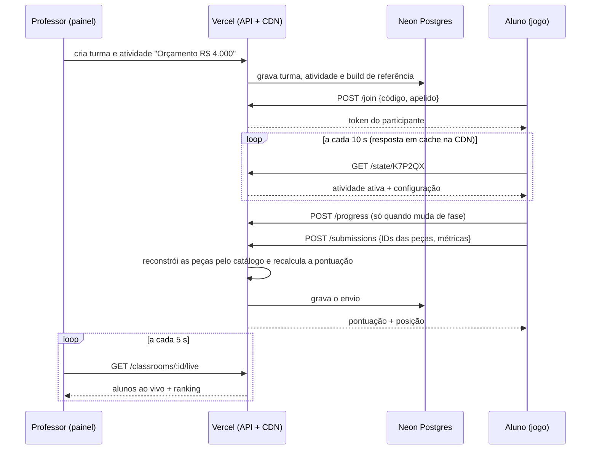

# 🎓 Especificação Técnica & Plano de Implementação: Modo Professor, Ranking e Modo Orçamento

> Decisão de arquitetura: [ADR-014](./adr/ADR-014-modo-professor-turmas-e-ranking-na-vercel.md).
> Público: quem vai implementar (pessoas e agentes do projeto). Siga o AGENTS.md: **teste antes da UI** para toda regra nova do motor.

## 1. Visão Geral

O professor abre um link, cria uma **turma**, recebe um código (`K7P2QX`) e escolhe a **atividade** da aula. Os alunos entram com o código e um apelido, jogam a atividade e enviam o resultado. O servidor recalcula a pontuação e monta o **ranking**. O professor acompanha tudo ao vivo e projeta o pódio no telão.

Três entregas:
1. **Gestão do professor:** turmas, atividades, acompanhamento ao vivo e moderação.
2. **Ranking e resultados:** ranking por atividade e por turma, destaques, telão, relatório e CSV.
3. **Modo Orçamento:** o professor define um valor em R$ e um perfil de cliente, e os alunos precisam montar o melhor PC que atenda o cliente sem passar do valor.

Restrição de projeto: **custo zero** (Vercel Hobby + Neon gratuito, uso didático e não comercial).



---

## 2. Ponto de Partida (o que já existe)

| Peça existente | Onde | Como entra no plano |
| :--- | :--- | :--- |
| Avaliação de missão por objetivos declarativos (`BUDGET_MAX`, `FPS_MIN`, `RAM_MIN_GB`…) | `src/engine/campaign.ts` → `evaluateMission` | O Modo Orçamento **gera uma `CampaignMission`** e reaproveita a avaliação inteira |
| Benchmark determinístico (FPS, gargalo, temperaturas) | `src/engine/benchmark.ts` → `calculateBenchmark` | Base dos pontos de desempenho e equilíbrio |
| Gasto da montagem (peças do cliente custam zero) | `campaign.ts` → `calculateMissionSpent` | Usado no servidor com preços do catálogo |
| Busca de peça por ID | `campaign.ts` → `findCatalogComponent` | Reconstrução das peças no servidor |
| Pontuação de 10.000 pts | `src/store/useAssemblyStore.ts` → `calculateFinalScore` | **Sai do store** e vira função pura (`scoring.ts`), corrigindo o `gpuInstalled ? 2000 : 800` (#26) |
| Código `PCA-…` com selo SHA-256 e placar local | `src/engine/validationCode.ts`, `src/engine/progress.ts`, `TeacherDashboardModal` | Continua como **plano B sem internet** (Modo A do ADR-005) |
| Service worker | `public/sw.js` | **Bloqueio:** hoje serve como cache-first todo GET que não é navegação, **inclusive `/api`**. Precisa ignorar `/api/` (MP-01) |

---

## 3. Arquitetura

```
src/
├─ engine/                      ← TypeScript puro, sem rede, testado com Vitest
│  ├─ scoring.ts                  pontuação unificada (cliente = prévia, servidor = oficial)
│  ├─ budgetChallenge.ts          perfis, viabilidade, build de referência, missão gerada
│  ├─ ranking.ts                  ordenação, desempates, destaques, visibilidade
│  └─ classroom/
│     ├─ types.ts                 Turma, Atividade, Participante, Envio (DTOs)
│     ├─ validation.ts            validação de entradas (apelido, código, config de atividade)
│     ├─ classCode.ts             gerador e normalizador do código da turma
│     └─ submission.ts            reconstrução da montagem a partir de IDs + plausibilidade
├─ server/                      ← só roda no servidor (import 'server-only')
│  ├─ repository.ts               interface ClassroomRepository
│  ├─ neonRepository.ts           implementação Postgres (@neondatabase/serverless)
│  ├─ memoryRepository.ts         implementação em memória (testes e E2E)
│  ├─ auth.ts                     scrypt, cookie HMAC, token do aluno, checagem de Origin
│  ├─ rateLimit.ts                janela fixa numa tabela do Postgres
│  └─ http.ts                     respostas JSON, erros padronizados, cabeçalhos de cache
├─ app/
│  ├─ api/v1/…                    Route Handlers (runtime nodejs)
│  ├─ professor/…                 painel do professor (rotas próprias, fora do bundle do jogo)
│  └─ t/[codigo]/page.tsx         atalho do QR code: abre o jogo com o código preenchido
├─ store/useClassroomStore.ts   ← estado do aluno na turma (token, atividade, posição)
└─ components/classroom/…       ← modal de entrada, banner da atividade, envio, minha posição
db/
└─ migrations/001_init.sql
scripts/db-migrate.mjs
```

Regras de dependência:
- `engine/` não importa nada de `server/`, `app/` ou `store/`. É o mesmo código no cliente e no servidor.
- `server/` importa `engine/`. As rotas importam `server/`.
- O jogo só baixa o código de turma quando o aluno entra numa turma (`dynamic import`). O painel do professor fica em rotas próprias e não pesa no bundle da bancada.

### 3.1 Interfaces trocáveis

```ts
// src/server/repository.ts
export interface ClassroomRepository {
  createTeacher(input: NewTeacher): Promise<Teacher>;
  findTeacherByUsername(username: string): Promise<TeacherWithSecrets | null>;
  createClassroom(teacherId: string, input: NewClassroom): Promise<Classroom>;
  listClassrooms(teacherId: string): Promise<Classroom[]>;
  getClassroomByCode(code: string): Promise<Classroom | null>;
  createActivity(classroomId: string, input: NewActivity): Promise<Activity>;
  setActivityStatus(activityId: string, status: ActivityStatus): Promise<Activity>; // garante 1 ATIVA por turma
  getPublicState(code: string): Promise<PublicClassroomState | null>;
  addParticipant(classroomId: string, displayName: string, tokenHash: string): Promise<Participant>;
  findParticipantByToken(tokenHash: string): Promise<Participant | null>;
  updateLiveState(participantId: string, live: LiveState): Promise<void>;
  saveSubmission(input: NewSubmission): Promise<Submission>;
  listSubmissions(activityId: string): Promise<SubmissionRow[]>;
  removeParticipant(participantId: string): Promise<void>;
  deleteClassroom(classroomId: string): Promise<void>;
  hitRateLimit(key: string, windowSeconds: number, max: number): Promise<boolean>;
}

// src/store/useClassroomStore.ts (cliente)
export interface ClassroomSync {
  join(code: string, displayName: string): Promise<JoinResult>;
  pollState(): Promise<PublicClassroomState>;
  reportProgress(live: LiveState): Promise<void>;
  submit(payload: SubmissionPayload): Promise<SubmissionReceipt>;
}
// LocalOnlySync: comportamento atual (sem turma). CloudSync: fala com /api/v1.
```

A implementação é escolhida pela variável `CLASSROOM_REPO=neon|memory`. Um `SqliteRepository` para o modo LAN pode entrar depois sem mexer nas rotas.

---

## 4. Modelo de Dados (`db/migrations/001_init.sql`)

```sql
CREATE TABLE teachers (
  id             uuid PRIMARY KEY DEFAULT gen_random_uuid(),
  username       text NOT NULL UNIQUE,            -- minúsculas, 3–32 caracteres [a-z0-9._-]
  display_name   text NOT NULL,
  password_hash  text NOT NULL,                   -- scrypt: salt$hash
  recovery_hash  text NOT NULL,                   -- código de recuperação exibido uma vez
  created_at     timestamptz NOT NULL DEFAULT now()
);

CREATE TABLE classrooms (
  id           uuid PRIMARY KEY DEFAULT gen_random_uuid(),
  teacher_id   uuid NOT NULL REFERENCES teachers(id) ON DELETE CASCADE,
  name         text NOT NULL,                     -- "1º Ano B — Informática"
  code         char(6) NOT NULL UNIQUE,           -- alfabeto sem 0/O/1/I/L
  joins_open   boolean NOT NULL DEFAULT true,     -- professor fecha a entrada depois da chamada
  archived_at  timestamptz,
  created_at   timestamptz NOT NULL DEFAULT now()
);

CREATE TYPE activity_status AS ENUM ('RASCUNHO', 'ATIVA', 'ENCERRADA');

CREATE TABLE activities (
  id           uuid PRIMARY KEY DEFAULT gen_random_uuid(),
  classroom_id uuid NOT NULL REFERENCES classrooms(id) ON DELETE CASCADE,
  kind         text NOT NULL,                     -- ver seção 6
  title        text NOT NULL,
  config       jsonb NOT NULL,                    -- validado por engine/classroom/validation.ts
  status       activity_status NOT NULL DEFAULT 'RASCUNHO',
  catalog_rev  text NOT NULL,                     -- hash do catálogo: congela preços e referência
  started_at   timestamptz,
  closed_at    timestamptz,
  created_at   timestamptz NOT NULL DEFAULT now()
);
-- No máximo uma atividade ativa por turma
CREATE UNIQUE INDEX one_active_activity ON activities (classroom_id) WHERE status = 'ATIVA';

CREATE TABLE participants (
  id            uuid PRIMARY KEY DEFAULT gen_random_uuid(),
  classroom_id  uuid NOT NULL REFERENCES classrooms(id) ON DELETE CASCADE,
  display_name  text NOT NULL,                    -- apelido ou "Bancada 03 – Ana e Léo"
  token_hash    text NOT NULL UNIQUE,             -- sha256 do token de 128 bits
  live          jsonb,                            -- {activityId, phase, percent, spent, penalties, updatedAt}
  removed_at    timestamptz,
  joined_at     timestamptz NOT NULL DEFAULT now(),
  UNIQUE (classroom_id, display_name)
);

CREATE TYPE submission_status AS ENUM ('VALIDO', 'SINALIZADO', 'INVALIDO');

CREATE TABLE submissions (
  id              uuid PRIMARY KEY DEFAULT gen_random_uuid(),
  activity_id     uuid NOT NULL REFERENCES activities(id) ON DELETE CASCADE,
  participant_id  uuid NOT NULL REFERENCES participants(id) ON DELETE CASCADE,
  attempt_no      smallint NOT NULL,
  build           jsonb NOT NULL,                 -- só IDs do catálogo + etapas da montagem
  metrics         jsonb NOT NULL,                 -- tempo, penalidades, errorLog, tentativas de POST
  completed       boolean NOT NULL,
  score_total     integer NOT NULL,
  breakdown       jsonb NOT NULL,                 -- ScoreBreakdown (seção 7)
  total_spent     integer NOT NULL,
  status          submission_status NOT NULL DEFAULT 'VALIDO',
  flags           text[] NOT NULL DEFAULT '{}',   -- motivos de SINALIZADO
  created_at      timestamptz NOT NULL DEFAULT now(),
  UNIQUE (activity_id, participant_id, attempt_no)
);
CREATE INDEX submissions_by_activity ON submissions (activity_id, score_total DESC);

CREATE TABLE rate_limits (
  key           text PRIMARY KEY,                 -- "join:<ip>:<code>", "login:<username>"…
  window_start  timestamptz NOT NULL,
  count         integer NOT NULL
);
```

Volume: um envio tem ~2 KB. Uma escola com 10 turmas × 30 alunos × 20 atividades × 3 tentativas ≈ 36 MB por ano, bem abaixo do espaço do plano gratuito do Neon (confira o limite atual ao ativar).

---

## 5. API (`/api/v1`, runtime Node.js)

### 5.1 Professor (cookie de sessão)

| Método e rota | Faz | Cache |
| :--- | :--- | :--- |
| `POST /auth/register` | Cria a conta e devolve o código de recuperação (exibido uma vez) | `no-store` |
| `POST /auth/login` · `POST /auth/logout` | Sessão por cookie assinado (12 h) | `no-store` |
| `POST /auth/recover` | Usuário + código de recuperação → nova senha e novo código | `no-store` |
| `GET/POST /classrooms` | Lista e cria turmas (gera o código) | `no-store` |
| `PATCH/DELETE /classrooms/:id` | Renomeia, abre/fecha entradas, arquiva, exclui (cascata) | `no-store` |
| `POST /classrooms/:id/activities` | Cria atividade (valida config, calcula referência do Modo Orçamento) | `no-store` |
| `POST /budget/analyze` | Prévia de viabilidade do Modo Orçamento para o formulário (seção 6.3) | `no-store` |
| `PATCH /activities/:id` | `RASCUNHO → ATIVA → ENCERRADA`; revelar build de referência | `no-store` |
| `GET /classrooms/:id/live` | Participantes ao vivo + ranking da atividade ativa (consultado a cada 5 s) | `no-store` |
| `GET /activities/:id/results` | Ranking completo, destaques, erros mais comuns, envios sinalizados | `no-store` |
| `GET /activities/:id/results.csv` | Exportação para planilha | `no-store` |
| `PATCH /submissions/:id` | Professor valida ou invalida um envio sinalizado | `no-store` |
| `DELETE /participants/:id` | Remove participante (apelido impróprio, duplicado) | `no-store` |

### 5.2 Aluno (token no cabeçalho `Authorization: Bearer …`)

| Método e rota | Faz | Cache |
| :--- | :--- | :--- |
| `POST /join` | `{code, displayName}` → `{participantToken, participantId, classroom}` | `no-store` |
| `GET /state/:code` | Atividade ativa e configuração pública. **Sem dados de alunos** | `public, s-maxage=10, stale-while-revalidate=20` |
| `POST /progress` | `{activityId, phase, percent, spent, penalties}`. Só ao mudar de fase, no máximo 1 a cada 15 s | `no-store` |
| `POST /submissions` | `{activityId, build, metrics}` → pontuação oficial, posição, tentativas restantes | `no-store` |
| `GET /activities/:id/ranking` | Top 10 público (se a visibilidade permitir) | `public, s-maxage=15` |
| `GET /me/position?activityId=` | Posição do próprio participante | `no-store` |

### 5.3 Regras transversais
- **Erros** no formato `{error: {code, message}}`, com mensagens em português que o jogo mostra direto (ex.: `TURMA_NAO_ENCONTRADA`, `ENTRADAS_FECHADAS`, `APELIDO_EM_USO`, `LIMITE_DE_TENTATIVAS`).
- **Limites de tentativa:** login 5 por 15 min por usuário; `join` 10 por minuto por IP + código; envio 1 a cada 20 s por participante, até `maxAttempts`.
- **Polling econômico:** o cliente pausa quando a aba fica oculta (`visibilitychange`) e volta a consultar ao reaparecer.
- **Verificação no deploy de preview:** `GET /state/:code` deve responder `x-vercel-cache: HIT` na segunda chamada. Se não responder, ajustar para `CDN-Cache-Control`.

---

## 6. Atividades

### 6.1 Tipos (`activities.kind` + `config`)

```ts
type ActivityConfig =
  | { kind: 'MISSAO_CAMPANHA'; missionId: string }              // qualquer missão de campaignMissions.ts
  | { kind: 'DESAFIO_EQUIPE'; missionId: string }               // trilha DESAFIO
  | { kind: 'DIAGNOSTICO'; scenarioId: string | 'SORTEADO' }
  | { kind: 'ORCAMENTO'; budget: BudgetChallengeConfig }        // seção 6.3
  | { kind: 'OFICINA_LIVRE' };                                  // sem ranking

interface ActivityCommon {
  instructions?: string;           // texto curto do professor, exibido no banner
  timeLimitSeconds?: number;       // o envio fecha ao estourar (o jogo avisa antes)
  maxAttempts: number;             // padrão 3
  attemptPolicy: 'MELHOR' | 'ULTIMO';
  rankingVisibility: 'AO_VIVO' | 'AO_ENCERRAR' | 'SO_PROFESSOR';
}
```

### 6.2 Ciclo de vida
`RASCUNHO` → (professor ativa) → `ATIVA` → (professor encerra ou o tempo acaba) → `ENCERRADA`.
Ativar uma atividade encerra a anterior da turma. Envios para atividade não ativa são recusados (`ATIVIDADE_ENCERRADA`).

### 6.3 Modo Orçamento

**Objetivo pedagógico:** decidir com dinheiro limitado e entender custo-benefício e gargalo. Gastar tudo não ganha o jogo; o que ganha é **desempenho por real** atendendo o cliente.

#### Configuração pelo professor

```ts
interface BudgetChallengeConfig {
  budget: number;                          // R$, inteiro
  profile: BudgetProfileId;                // ou 'PERSONALIZADO'
  requirements?: BudgetRequirements;       // obrigatório quando PERSONALIZADO
  resolution: '1080p' | '1440p';
  targetTimeSeconds: number;               // padrão 600 (escolher peças leva mais tempo)
  reference: BudgetReference;              // calculada pelo servidor na criação e congelada
}

interface BudgetRequirements {
  minRamGb: number;
  minStorageGb: number;
  storageType?: 'NVMe_M2' | 'SATA_SSD';
  minFps?: number;                         // na resolução escolhida
  requireDedicatedGpu: boolean;
}
```

| Perfil | Cliente da história | Requisitos obrigatórios | Bônus (estrelas) |
| :--- | :--- | :--- | :--- |
| `ESTUDOS` | Estudante do EAD | RAM ≥ 8 GB, SSD ≥ 256 GB, vídeo integrado aceito | Dual channel, fonte recomendada |
| `ESCRITORIO` | Secretaria da escola | RAM ≥ 8 GB, SSD ≥ 500 GB, sem GPU dedicada exigida | Zero penalidades, fonte recomendada |
| `JOGOS_1080P` | Gamer iniciante | ≥ 60 FPS em 1080p, RAM ≥ 16 GB, SSD ≥ 500 GB | Dual channel, gargalo ≤ 15% |
| `JOGOS_1440P` | Gamer competitivo | ≥ 60 FPS em 1440p, RAM ≥ 16 GB, NVMe ≥ 1 TB | Gargalo ≤ 15%, CPU ≤ 85 °C |
| `CRIADOR` | Editora de vídeo | RAM ≥ 32 GB, NVMe ≥ 1 TB, CPU ≤ 85 °C | Dual channel, fonte recomendada |
| `PERSONALIZADO` | Definido pelo professor | Campos de `BudgetRequirements` | Dual channel, zero penalidades |

Todos os perfis também exigem `POST_OK` e `BUDGET_MAX = budget`.

#### Viabilidade e build de referência (`analyzeBudget`)

Função pura em `src/engine/budgetChallenge.ts`:

```ts
analyzeBudget(budget, requirements, resolution) → {
  feasible: boolean;
  cheapestCost: number;            // PC mais barato que atende os requisitos
  cheapestBuild: BuildIds;
  reference: { build: BuildIds; score: number; avgFps: number; cost: number; bottleneckPercent: number };
  ceilingCost: number;             // custo do melhor PC possível sem limite de orçamento
}
```

Algoritmo: busca exaustiva em CPU × placa (soquete compatível) × RAM (tipo compatível, 1 ou 2 pentes) × GPU (incluindo "sem GPU" quando a CPU tem vídeo integrado). Com o catálogo atual (18 CPUs, 14 placas, 13 RAMs, 12 GPUs) são no máximo ~45 mil combinações antes da poda. Para cada combinação, escolhe-se gulosamente a peça mais barata que atende: cooler (capacidade ≥ TDP), fonte (≥ recomendada), armazenamento (requisito), gabinete (formato e comprimento da GPU). A referência é a combinação de **maior `benchmark.score`** com custo ≤ orçamento. Meta: < 200 ms, coberta por teste.

O formulário do professor chama `POST /budget/analyze` e mostra, antes de salvar:
- ❌ "Abaixo do PC mais barato que atende esse cliente (R$ 2.870)" → bloqueia.
- ✅ "Melhor PC possível com R$ 4.000: ~92 FPS em 1080p".
- ⚠️ "Acima de R$ 9.400 o orçamento deixa de ser desafio: dá para comprar o melhor de tudo".

A referência fica **congelada** em `config.reference` com o `catalog_rev`. Mudanças futuras no catálogo não alteram atividades já criadas.

#### Experiência do aluno
- **Briefing:** cliente, perfil, valor, requisitos e tempo-alvo. Reaproveita o visual de `MissionHeader`/`ActiveMissionPanel`.
- **Saldo ao vivo no HUD:** o `TopHUD` já mostra o orçamento. No Modo Orçamento, o saldo muda de cor ao passar de 90% do valor e ao estourar. Pela equivalência multimodal do AGENTS.md, o estouro também gera texto ("Orçamento estourado em R$ 230"), ícone e um som curto procedural.
- **Card de peça:** mostra "cabe no saldo" / "estoura o saldo em R$ X" antes de instalar.
- **Entrega:** o `MissionDebriefModal` mostra o detalhamento dos pontos e compara com a referência **somente depois que o professor revela** a build de referência ou a atividade encerra. Assim a solução não vaza para a turma no meio da aula.

---

## 7. Pontuação (`src/engine/scoring.ts`)

### 7.1 Princípios
- **Função pura, mesmo código no cliente e no servidor.** O cliente mostra a prévia; o servidor grava o valor oficial.
- O servidor recebe **só IDs do catálogo** e reconstrói as peças com `findCatalogComponent`. Preço, TDP e desempenho enviados pelo cliente são ignorados. ID desconhecido → `400 PECA_DESCONHECIDA`.
- Máximo de **10.000 pontos** em todos os modos (ADR-005).

```ts
interface ScoreBreakdown {
  total: number;
  completed: boolean;              // objetivos obrigatórios cumpridos
  parts: { key: ScorePartKey; label: string; points: number; max: number; explanation: string }[];
  totalSpent: number;
  benchmark: { score: number; avgFps: number; bottleneckPercent: number };
  stars: 0 | 1 | 2 | 3;            // vem de evaluateMission
}
```

### 7.2 Modos de missão, desafio e diagnóstico (substitui `calculateFinalScore`, fecha #26)

| Parte | Máx | Cálculo |
| :--- | ---: | :--- |
| Precisão | 4.000 | `max(500, 4000 − 500 × penalidades)` *(igual a hoje)* |
| Orçamento | 2.500 | Sem orçamento: 2.500. Com orçamento: estourou → 0; senão `1500 + 1000 × saldo / orçamento` *(igual a hoje)* |
| Desempenho e equilíbrio | 2.000 | `1000 × min(1, score / meta)` + `1000 × equilíbrio`. A meta vem da missão (`targetBenchmarkScore`/`FPS_MIN`) ou de uma referência fixa. **Substitui `gpuInstalled ? 2000 : 800`** |
| Velocidade | 1.500 | `min(1500, 5 × max(0, 300 − segundos))` *(igual a hoje)* |

`equilíbrio = 1` com gargalo ≤ 10%, cai linearmente até `0` com gargalo ≥ 40%.

Antes de mover, um teste congela os valores atuais de precisão, orçamento e velocidade. Assim a extração não muda nada além da parte de desempenho.

### 7.3 Modo Orçamento

| Parte | Máx | Cálculo |
| :--- | ---: | :--- |
| Precisão | 3.000 | `max(500, 3000 − 500 × penalidades)` |
| Desempenho | 3.000 | `3000 × min(1, score / referência.score)` |
| Custo-benefício | 2.000 | `2000 × min(1, (score / gasto) / (ref.score / ref.custo))`. Estourou o orçamento → 0 |
| Equilíbrio | 1.000 | `1000 × equilíbrio` (mesma curva de gargalo) |
| Velocidade | 1.000 | `1000 × clamp((2T − t) / T, 0, 1)`: cheio até o tempo-alvo `T`, zero em `2T` |

Por que é justo:
- Um PC fraco e barato tem bom custo-benefício, mas perde desempenho e pode nem atender o cliente.
- Gastar tudo numa GPU com CPU fraca perde equilíbrio e custo-benefício.
- Igualar a referência dá ~9.000 ou mais, e a precisão separa quem montou com cuidado.

**Não concluído** (requisito não atendido, POST falhou ou orçamento estourado): a pontuação é calculada e mostrada para aprendizado, mas o envio fica **abaixo de todos os concluídos** no ranking.

### 7.4 Plausibilidade (`engine/classroom/submission.ts`)

| Verificação | Resultado |
| :--- | :--- |
| ID de peça inexistente, kit de RAM em slots impossíveis, peças incompatíveis declaradas como instaladas | `400`, envio recusado |
| `tempo do cliente` > janela do servidor (do `join` ou do início da atividade até o envio) + 60 s | `SINALIZADO: TEMPO_INCOERENTE` |
| Montagem completa em menos de 45 s | `SINALIZADO: TEMPO_IMPOSSIVEL` |
| `penalidades` < número de erros no `errorLog` | `SINALIZADO: PENALIDADES_INCOERENTES` |

Envios sinalizados aparecem no ranking do professor com ⚠ e o motivo, e **ficam fora do ranking dos alunos** até o professor validar.

---

## 8. Ranking e Resultados (`src/engine/ranking.ts`)

### 8.1 Ranking da atividade
1. Considera só envios `VALIDO` (o professor vê também os `SINALIZADO`).
2. Por participante, escolhe o **melhor** ou o **último** envio, conforme `attemptPolicy`.
3. Ordena: concluídos antes de não concluídos → pontuação ↓ → desempate.
4. Desempate: missões e desafios: **menos penalidades → menor tempo → envio mais antigo**. Modo Orçamento: **menor gasto → menos penalidades → menor tempo → envio mais antigo**.
5. Empate exato divide a posição (`1º, 1º, 3º`), sem sorteio.

### 8.2 Ranking da turma
Soma do envio escolhido em cada atividade **encerrada** com ranking. Mostra também o número de atividades feitas, para o professor perceber quem faltou.

### 8.3 Destaques por categoria
Para reconhecer mais alunos que só o pódio, cada atividade encerrada calcula:

| Destaque | Critério |
| :--- | :--- |
| 🏆 Pódio | 1º, 2º e 3º lugar |
| ⚡ Mais rápido | Menor tempo entre os concluídos |
| 💰 Melhor custo-benefício | Maior `score / gasto` (Modo Orçamento) |
| 🎯 Montagem limpa | Concluiu com zero penalidades (pode ter vários) |
| ⚖️ Mais equilibrado | Menor gargalo entre os concluídos |

### 8.4 Quem vê o quê

| Visibilidade | Aluno durante a atividade | Aluno após encerrar | Professor |
| :--- | :--- | :--- | :--- |
| `AO_VIVO` | Top 10 + a própria posição | Top 10 + destaques + a própria posição | Tudo |
| `AO_ENCERRAR` | Só a própria pontuação | Top 10 + destaques + a própria posição | Tudo |
| `SO_PROFESSOR` | Só a própria pontuação | Só a própria pontuação e posição | Tudo |

O aluno nunca vê a lista inteira com as últimas posições.

### 8.5 Telas
- **Painel ao vivo do professor** (`/professor/turmas/[id]`): grade com um cartão por bancada (fase, % do checklist, gasto, penalidades) e alerta "parado há 3 min" calculado pelo `updatedAt`. Ao lado, ranking da atividade ativa.
- **Telão** (`/professor/turmas/[id]/projetar`): tela cheia, fonte grande, pódio animado (respeita `prefers-reduced-motion`), destaques, QR code e código da turma para quem ainda não entrou. Atualiza a cada 5 s e anuncia mudanças de posição com `aria-live="polite"`.
- **Relatório da atividade:** ranking completo, distribuição das notas, **erros mais comuns da turma** (agregado do `errorLog`, parte de #34), envios sinalizados e **exportação CSV** (`apelido; posição; pontuação; concluído; gasto; tempo; penalidades; tentativas; status; peças`).
- **No jogo (aluno):** depois do envio, o debriefing mostra pontuação oficial, posição ("Você está em 4º de 27") e tentativas restantes.

---

## 9. Segurança, LGPD, Acessibilidade e Desempenho

- **Senhas:** `scrypt` (`node:crypto`), salt por usuário, comparação em tempo constante. Código de recuperação de 12 caracteres, guardado só como hash.
- **Sessão:** cookie `pcba_session` = `teacherId.expira.HMAC-SHA256`, com `HttpOnly`, `Secure`, `SameSite=Lax` e duração de 12 h. Mutações exigem `Origin` igual ao host.
- **Código da turma:** 6 caracteres do alfabeto `ABCDEFGHJKMNPQRSTUVWXYZ23456789` (~887 milhões de combinações) + limite de tentativas + o professor pode fechar a entrada.
- **Apelido:** 2 a 32 caracteres, normalizado (NFC, espaços colapsados), sem URLs. O professor remove os impróprios.
- **LGPD:** nenhum dado pessoal obrigatório do aluno (orientação na tela: primeiro nome + bancada). Exclusão de turma em cascata. Rotina diária (Vercel Cron) apaga turmas arquivadas há mais de 12 meses e limpa a tabela `rate_limits`.
- **Acessibilidade (WCAG 2.2 AA):** ranking em `<table>` semântica, alvos de 44 × 44 px, formulários com rótulos e erros associados, tudo operável por teclado, cor nunca como único indicador (saldo, ⚠ sinalizado).
- **Desempenho:** painel do professor e telão em rotas próprias. O `CloudSync` só é carregado quando o aluno entra numa turma. O polling para com a aba oculta.

---

## 10. Uso Estimado do Plano Hobby

| Origem | Execuções por aula (30 alunos, 50 min) |
| :--- | ---: |
| `GET /state` (1 execução a cada 10 s; o resto vem da CDN) | ~300 |
| Painel do professor (1 cliente, a cada 5 s) | ~600 |
| `join` + `progress` (~10 mudanças de fase) + envios (até 3) | ~420 |
| **Total** | **~1.300** |

Limite mensal: 1.000.000 de execuções e 4 h de CPU ativa. Com ~20 ms de CPU por execução, cada aula gasta ~30 s de CPU, o que dá **várias centenas de aulas por mês**. A CPU acaba antes das execuções; acompanhe pelo painel de uso da Vercel nas primeiras semanas (MP-16).

---

## 11. Configuração e Deploy

1. Vercel → projeto → **Storage → Marketplace → Neon → plano Free**. A integração cria `DATABASE_URL` em Production e Preview.
2. Gerar o segredo de sessão (`openssl rand -base64 32`) e cadastrar `CLASSROOM_SECRET` nas variáveis do projeto.
3. `CLASSROOM_REPO=neon` em Production e Preview; `memory` no `.env.local` para desenvolver sem banco.
4. Rodar a migração: `DATABASE_URL=… npm run db:migrate` (script idempotente que registra as migrações aplicadas numa tabela `schema_migrations`).
5. `vercel.json`: cron diário de retenção (`/api/v1/cron/retention`, protegido por `CRON_SECRET`). No Hobby, crons rodam no máximo uma vez por dia, o que basta.
6. No primeiro deploy de preview, conferir `x-vercel-cache: HIT` em `GET /state/:code` (seção 5.3).

---

## 12. Estratégia de Testes (test-first)

| Camada | Ferramenta | O que cobre |
| :--- | :--- | :--- |
| Motor | Vitest | `scoring.ts` (valores atuais congelados antes da extração, curva de equilíbrio, Modo Orçamento), `analyzeBudget` (viabilidade, referência comparada a uma força bruta numa fixture pequena, tempo < 200 ms), `buildBudgetMission` + `evaluateMission`, `ranking.ts` (desempates, melhor/último, concluídos primeiro, empate dividido, visibilidade, destaques), validações, `classCode`, reconstrução da montagem e plausibilidade |
| Servidor | Vitest + `MemoryRepository` | Route Handlers chamados com `Request` real: autenticação, permissão (professor A não vê a turma de B), ciclo de vida da atividade, limites de tentativa, cabeçalhos de cache |
| Ponta a ponta | Playwright, `CLASSROOM_REPO=memory` | 1 contexto de professor + 2 de alunos: criar turma e atividade de orçamento → alunos entram, montam e enviam → ranking na ordem certa → aluno vê a própria posição → encerrar → destaques |
| Manual no preview | Navegador | Cache da CDN, banco real, telão num projetor de 1366 × 768 |

---

## 13. Issues

Épico: **#82**. Ordem sugerida: P0 → P1 → P2 → P3. Dentro de cada grupo, as issues de motor vêm antes das de interface.

| ID | Issue | Prioridade | Depende de |
| :--- | :--- | :--- | :--- |
| MP-01 | **#66** fix(pwa): service worker não deve cachear `/api/` | P0 | — |
| MP-02 | **#26** feat(score): pontuação pura em `scoring.ts` com benchmark real *(issue existente, critérios ampliados)* | P0 | — |
| MP-03 | **#67** feat(orcamento): motor do Modo Orçamento — perfis, viabilidade e build de referência | P0 | — |
| MP-04 | **#68** feat(orcamento): pontuação e desempate do Modo Orçamento | P0 | MP-02, MP-03 |
| MP-05 | **#69** feat(ranking): motor puro de ranking, destaques e visibilidade | P0 | MP-02 |
| MP-06 | **#70** feat(orcamento): Modo Orçamento jogável sem turma (briefing, saldo ao vivo, entrega) | P1 | MP-03, MP-04 |
| MP-07 | **#71** feat(backend): Neon, schema, migração e `ClassroomRepository` | P1 | — |
| MP-08 | **#72** feat(backend): autenticação do professor | P1 | MP-07 |
| MP-09 | **#73** feat(backend): API de turmas e atividades | P1 | MP-08, MP-03 |
| MP-10 | **#74** feat(backend): entrada do aluno, estado em cache na CDN e progresso ao vivo | P1 | MP-01, MP-09 |
| MP-11 | **#75** feat(backend): envio de resultado com pontuação oficial e plausibilidade | P1 | MP-02, MP-04, MP-10 |
| MP-12 | **#76** feat(professor): painel — login, turmas e criação de atividades | P2 | MP-09 |
| MP-13 | **#77** feat(professor): acompanhamento ao vivo e telão de ranking | P2 | MP-05, MP-11, MP-12 |
| MP-14 | **#78** feat(aluno): entrar na turma, banner da atividade, envio e minha posição | P2 | MP-10, MP-11 |
| MP-15 | **#79** feat(resultados): relatório da atividade, erros mais comuns e CSV *(parte de #34)* | P2 | MP-05, MP-11 |
| MP-16 | **#80** test(e2e): professor + alunos, auditoria de acessibilidade e medição de uso | P3 | MP-13, MP-14 |
| MP-17 | **#81** feat(lgpd): exclusão, remoção de participante e rotina de retenção | P3 | MP-09 |

---

## 14. Riscos e Questões em Aberto

| Risco | Mitigação |
| :--- | :--- |
| A rede da escola bloqueia `*.vercel.app` ou o Neon | Testar antes da primeira aula. O jogo continua funcionando sem turma, e o código `PCA-…` segue como plano B |
| Atraso de até ~30 s para a troca de atividade | Aviso no painel. Botão "Atualizar" no banner do aluno força a consulta (com limite) |
| Alunos compartilhando o token para enviar por outro | Token preso ao participante. O professor vê envios sinalizados e pode remover participantes |
| Catálogo muda no meio do semestre | `catalog_rev` congela a referência por atividade. Peças removidas continuam no catálogo como "descontinuadas" |
| Projeto passar a ter fins comerciais | O Hobby deixa de valer; é preciso migrar para o Pro (ADR-014) |
| O plano gratuito do Neon mudar | O `ClassroomRepository` permite trocar por outro Postgres gratuito sem tocar nas rotas |
