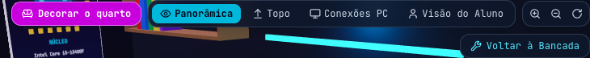
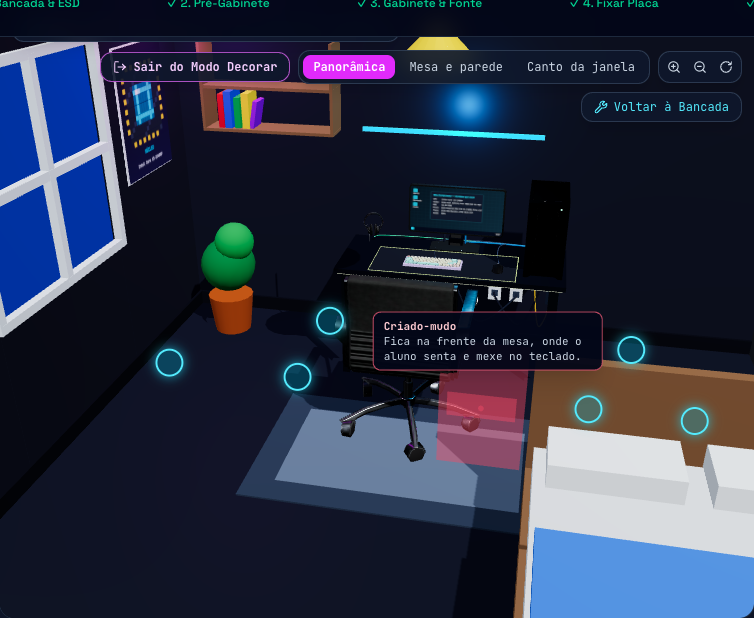
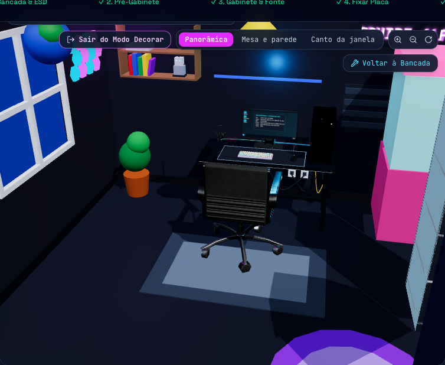
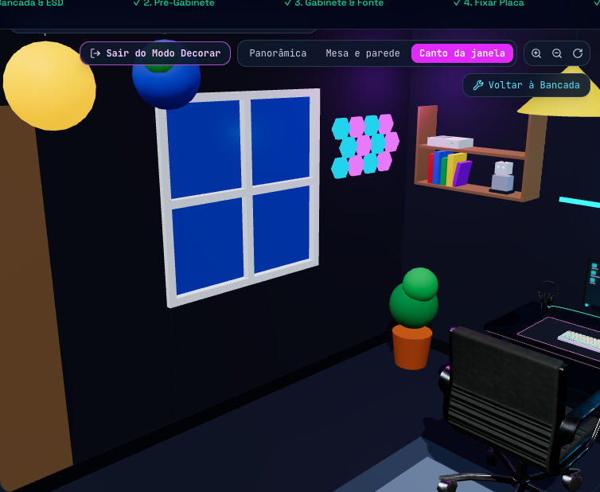
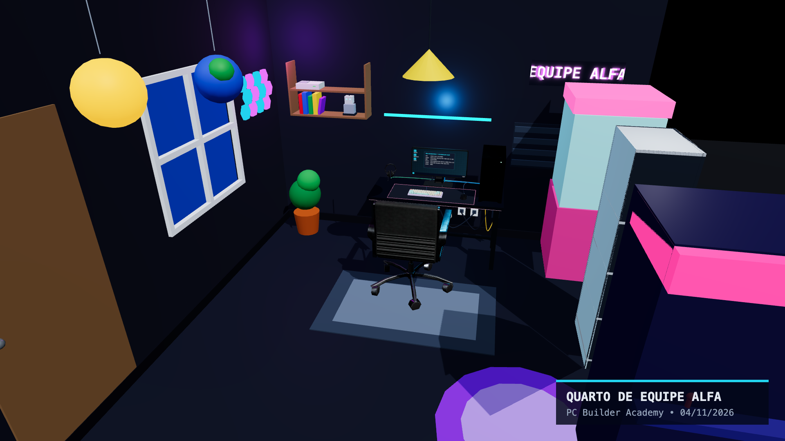
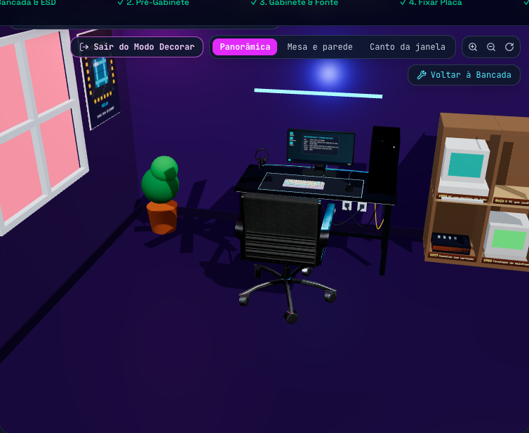

# Relatório da feature: Modo Decorar o Quarto

* **Épico:** #92 · **Issues:** #83 a #91
* **Branch / PR:** `feat/modo-decorar-quarto` (empilhada sobre `feat/issues-23-a-63`)
* **Especificação de origem:** `docs/modo-decorar-quarto.md`, `docs/modelos-3d-decoracao.md` e `.json`
* **Data:** 2026-11-04

## 1. O que o aluno ganhou

Quando o PC montado na bancada **liga na mesa e o AcademyOS sobe**, aparece o botão
**Decorar o quarto**. A sala da mesa vira o quarto do aluno: 4 m × 4 m, com a parede das tomadas,
janela, porta e o tema escolhido (Gamer, Escritório, Laboratório ou Retrô). Cada tema começa com um
conjunto inicial do pacote Clássico, que o aluno muda à vontade.

| Gaveta com pacotes e progresso | Itens bloqueados mostram a conquista |
| :---: | :---: |
|  |  |

**Como decorar** (equivalência entre mouse, touchpad gasto e teclado, como pede o AGENTS.md):

| Ação | Mouse/touchpad | Teclado | Só clique |
| :--- | :--- | :--- | :--- |
| Pegar item | Arrastar o card da gaveta | Tab até o card + Enter | Clicar no card |
| Posicionar | Soltar no quarto (fantasma verde/vermelho) | Setas movem 10 cm, Enter confirma | Clicar num ponto destacado |
| Girar | Botões ↺ ↻ | Q / E | Botões ↺ ↻ |
| Mover | Arrastar a peça no quarto | Lista "Itens no quarto" → Mover | Lista → Mover |
| Remover | Arrastar a peça de volta para a gaveta | Delete | Lista → Remover |
| Desfazer | — | Ctrl+Z | Botão Desfazer |

O **fantasma** fica verde onde a peça cabe e vermelho onde não cabe, com o motivo em português
(o mesmo texto vai para a região anunciada pelo leitor de tela):

| Quarto Gamer decorado | Vista "Canto da janela" |
| :---: | :---: |
|  |  |

**Foto do quarto** em 1920 × 1080, com três ângulos prontos e o selo da equipe e da data:

**Museu do PC** (ao concluir a campanha): estante "Linha do tempo" com placas de ano, do console de
1977 ao PC que o aluno montou:

## 2. Arquitetura

As regras ficam no motor puro (`src/engine`, sem React), com testes escritos antes da UI.
Tudo do modo é baixado só quando é usado: a bancada não fica mais pesada.

| Módulo | Responsabilidade |
| :--- | :--- |
| `models3d.ts` + `models3d.data.json` (#83) | Grupo `DECOR`, 9 categorias novas e as 68 entradas da curadoria |
| `roomLayout.ts` (#84) | Quarto, parede das tomadas, janela, porta, zonas proibidas e o contexto da mesa real do aluno |
| `roomDecor.ts` (#84, #88, #89) | Catálogo: 68 modelos + 6 itens por código, curiosidade didática, pegada, zonas, variantes, limites |
| `roomPlacement.ts` (#84) | `canPlace`, encaixe em grade, prateleiras, setas, rotação, pontos destacados e orçamento de desempenho |
| `decorUnlocks.ts` (#85) | Regras de desbloqueio, texto da conquista, progresso (2/3) e troféus da vitrine |
| `roomDecorState.ts` (#90) | Conjunto inicial por tema, colocar, mover, retirar e `sanitizeRoomDecor` |
| `useRoomDecorStore` (#90) | Quarto persistido com `safeStorage`, desfazer e "Recomeçar quarto" |
| `room3d/RoomShell.tsx` (#86) | Piso, paredes, janela, porta e tomadas por tema (substitui a sala do laboratório) |
| `room3d/DecorScene.tsx` (#87, #88, #91) | Peças, fantasma, superfícies de encaixe, pontos destacados, vitrine, museu e foto |
| `room3d/DecorDrawer.tsx` (#87) | Gaveta, item em mãos, lista "Itens no quarto", teclado e foto |
| `room3d/decorShapes.ts`, `posterArt.ts` (#88) | Versões leves feitas por código e arte original dos pôsteres em `<canvas>` |

Carregamento: `DecorScene` por `React.lazy` (só ao abrir o Modo Decorar ou com um quarto já salvo) e
`DecorDrawer` por `next/dynamic`. O estado efêmero (item em mãos, seleção) fica em
`decorModeStore.ts`, um módulo de 3 KB sem o catálogo.

### 2.1 Regras de posicionamento

* **Grade:** chão 10 cm com rotação de 90°, parede 10 cm entre 30 cm e 2,40 m de altura, mesa 5 cm,
  teto 25 cm.
* **Colisão:** caixa 3D de cada peça depois da rotação contra as outras peças e contra mesa, cadeira,
  gabinete, monitor, teclado, mouse, mousepad e caixas de som. Tapetes ficam por baixo de móveis e da
  cadeira (só colidem com outros tapetes).
* **Zonas proibidas:** abertura da porta, caminho da cadeira, frente da mesa e trajeto dos cabos do
  gabinete até as tomadas. Na parede, a decoração não cobre janela, porta nem tomadas; a persiana só
  vai na janela.
* **Mesa:** só nas áreas livres do tampo que os periféricos do aluno não ocupam.
* **Prateleiras:** prateleira de parede, estante, vitrine, aparador e "Linha do tempo" têm nichos;
  um item só entra num nicho livre em que caiba. Mover a estante leva junto o que está nela; retirar
  a estante retira tudo.

| Recusa | Exemplo de mensagem |
| :--- | :--- |
| `FORA_DO_QUARTO` | "Na parede, a decoração fica entre 30 cm e 2,40 m de altura." |
| `COLISAO` | "Encosta na mesa: escolha um lugar livre." |
| `ZONA_PROIBIDA` | "Esse lugar bloqueia o caminho dos cabos da tomada." |
| `SEM_SLOT` | "Esse nicho da prateleira já está ocupado." |
| `LIMITE_DO_ITEM` | "Limite de 1 unidade de Fliperama no quarto." |
| `LIMITE_DO_QUARTO` | "O quarto já tem 12 itens, o limite para manter 60 FPS neste computador." |

### 2.2 Desbloqueios (#85)

| Pacote / item | Regra |
| :--- | :--- |
| Clássico (32 itens, incluindo fita LED, pôster e aparador) | PC ligado na mesa uma vez |
| Fliperama, máquina de garra | Concluir a trilha Desafio em Grupos |
| Óculos VR, cadeira gamer | Concluir a trilha Mesa & Battlestation |
| Arcade stick, neon de controle / letreiro animado | POST de primeira 3 / 5 vezes |
| Troféu, vitrine / painéis hexagonais / pelúcias | 1 / 2 / 3–5 missões com 3 estrelas |
| Microscópio, robôs, dados | Casos resolvidos no modo diagnóstico |
| Telescópio, planetas, capacete, xadrez, globo, cubo | Perguntas de fixação certas |
| Raspberry Pi, Arduino (e drone, junto com 3 diagnósticos) | Concluir um Desafio de Orçamento |
| Museu do PC | Concluir a campanha (Prova Final) |

O progresso salvo ganhou três campos (versão 2, com migração da versão 1): primeira vez com o PC
ligado na mesa, POSTs de primeira e casos resolvidos. A vitrine mostra um troféu por missão com
3 estrelas nos nichos livres. O modo professor "liberar todas as missões" libera toda a decoração.

### 2.3 Itens feitos por código (#88)

* **Fita LED:** cor do tema, respirar, arco-íris e onda (parada com movimento reduzido).
* **Painéis hexagonais:** 12 painéis numa única `InstancedMesh`, com padrões de cor.
* **Neon com texto:** até 12 caracteres, sem links e com filtro de palavras; quatro cores.
* **Pôsteres e quadros:** arte original desenhada em `<canvas>`: processador em arte pixel, mapa de
  soquetes, gráfico de FPS do PC do aluno (1080p, 1440p, 4K), certificado da equipe e ficha do setup.

### 2.4 Quarto salvo e foto (#90)

* Persistido em `localStorage` (`pcba-quarto-v1`) via `safeStorage`. Ao abrir, `sanitizeRoomDecor`
  descarta item desconhecido, bloqueado, com texto proibido ou que deixou de caber (por exemplo,
  o aluno trocou a mesa por uma menor). A ordem da lista se mantém depois do F5.
* "Recomeçar quarto" pede confirmação e pode ser desfeito com Ctrl+Z. "Começar do zero" do jogo
  também apaga o quarto.
* Foto: um quadro 1920 × 1080 é renderizado sob demanda e copiado na mesma tarefa, sem
  `preserveDrawingBuffer` permanente; o selo é desenhado num canvas 2D e salvo com `toBlob`.

## 3. Desempenho (#91)

| Limite | Nível alta | Nível leve (vídeo integrado) |
| :--- | ---: | ---: |
| Itens no quarto | 24 | 12 |
| Faces somadas (modelos reais) | 150 mil | 75 mil |
| Textura dos pôsteres | 512 px | 512 px |
| Itens animados | 4 (0 com movimento reduzido) | 4 (0 com movimento reduzido) |

* `canPlace` recusa com `LIMITE_DO_QUARTO` e diz qual limite estourou.
* Peças repetidas e estáticas (espuma acústica, livros, vasos...) viram uma `InstancedMesh` por
  primitiva; os hexágonos são sempre instanciados.
* Geometrias e materiais compartilhados ficam num cache liberado (`dispose`) ao sair da mesa; as
  texturas de canvas são liberadas quando a arte muda ou a peça sai.
* Bundle e medição: ver [performance.md](./performance.md#modo-decorar-o-quarto-91).

## 4. Acessibilidade (#91)

* A gaveta é um `aside` com rótulo, os pacotes são abas (`tablist`/`tab`/`tabpanel`) e os cards de
  itens bloqueados dizem a conquista e o progresso no nome acessível ("Fliperama, bloqueado.
  Conclua a trilha 'Desafio em Grupos' (0 de 4)").
* Os pontos destacados do quarto são botões HTML ("Colocar aqui: no chão, à direita, perto da parede
  do fundo"): dá para decorar pelo leitor de tela sem mirar no canvas.
* "Itens no quarto" lista cada peça e onde ela está, com Selecionar, Mover, Girar e Remover.
* Mensagens de recusa e de sucesso numa região `role="status"`, com cor, texto e som (a cor nunca
  é o único sinal).
* Alvos de 40–44 px, foco visível e teclado completo (setas, Q/E, Enter, Esc, Delete, Ctrl+Z).
* Movimento reduzido: sem mola ao soltar, sem animação das peças e sem efeitos da fita LED.
* Auditoria feita nos testes E2E (teclado, 375 px sem rolagem horizontal) e por inspeção do código.
  **Falta** conferir com um leitor de tela real (NVDA/VoiceOver).

## 5. Testes

| Tipo | Arquivo | O que garante |
| :--- | :--- | :--- |
| Unitário | `roomDecor.test.ts` (40) | Catálogo × manifesto (licença, faces ≤ 20 mil, faces iguais às do manifesto), pacotes, nichos, neon; grades, parede, fora do quarto, zona errada, colisão com rotação, tapete por baixo, mesa/cadeira/torre, zonas proibidas, janela/porta/tomadas/persiana, áreas livres da mesa, prateleiras, mover estante, limites por item e do quarto (itens, faces, animados), setas e rotação, pontos destacados válidos, conjunto inicial de cada tema em duas mesas, sanitização (lixo, bloqueado, posição inválida, neon proibido, estante ausente, mesa trocada, ordem) |
| Unitário | `decorUnlocks.test.ts` (19) | Cada regra com progresso vazio, parcial e completo; texto e progresso (2/3); diagnóstico sem contar duas vezes; orçamento fora das missões; professor libera tudo; Clássico libera com o PC ligado; regras da especificação; troféus da vitrine; migração do progresso v1 → v2 |
| Unitário | `decorShapes.test.ts` (3) | Toda peça tem versão própria, dentro da pegada, com até 30 primitivas |
| E2E | `decorRoom.spec.ts` (5) | Botão só com o AcademyOS em execução; colocar por clique e por **arraste real**; só teclado; girar; recusa com a mensagem no fantasma e na região anunciada; remover e desfazer; card bloqueado; F5 com o quarto igual; **foto PNG 1920 × 1080**; modo professor; peças instanciadas; 375 px |

Os testes de fluxo completo existentes (bancada → mesa → cabos → boot) continuam passando com a sala
nova. Rodada final: `tsc` limpo, **568 testes unitários** em 43 arquivos e **43/43 testes E2E**
(Chromium 1366x768 e 375 px); `next build` compila com o JS inicial de 291 → 292 kB.

## 6. Decisões e desvios da especificação

* **Modelos ainda não baixados.** O download exige o token do Sketchfab, que não está neste
  ambiente. O manifesto, os créditos e o caminho de carregamento estão prontos: cada peça usa o
  `.glb` assim que ele existir em `public/models` (índice gerado por `npm run models:optimize`) e,
  até lá, uma versão leve feita por código. As pegadas são medidas reais aproximadas dos objetos;
  `npm run models:measure` deve confirmá-las depois do download.
* **Aparador** (item por código, pacote Clássico): com teclado, mouse, monitor e torre, o tampo de
  uma mesa padrão não comporta itens de 40 cm ou mais (TV de tubo, xadrez, toca-discos, PCs do
  museu). Esses itens também vão em nichos de prateleira, e o aparador oferece dois nichos grandes.
* **Linha do tempo** em 2 × 2 nichos (95 cm de largura) para caber nas paredes do quarto.
* **Itens animados:** o limite de 4 vale em `canPlace` nos dois níveis; o movimento reduzido para as
  animações sem recusar peças.
* **Fita LED** é uma peça de parede, colocada atrás da mesa e do monitor.
* **Tema** salvo no quarto e no setup (`selectedRoomTheme`), para a sala e a foto do ADR-006
  usarem o mesmo.

## 7. Pendências

* **#83 e #89:** rodar `SKETCHFAB_API_TOKEN=… node scripts/download-models.mjs`,
  `npm run models:optimize` e `npm run models:measure`; conferir o visual de cada modelo (tela do
  fliperama e da TV sem marcas de jogos), confirmar os pesados (cadeira gamer, telescópio, máquina de
  garra, computadores antigos) e marcar os ☐ da curadoria.
* **#86 e #91:** medir FPS e memória no hardware da escola (roteiro em
  [performance.md](./performance.md#modo-decorar-o-quarto-91)) e conferir com leitor de tela.
