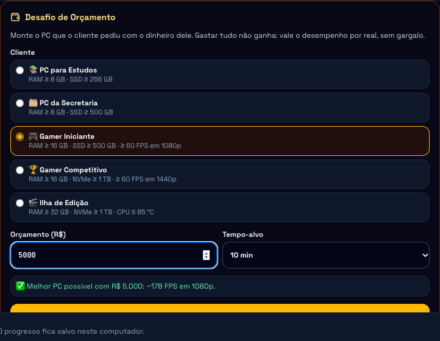
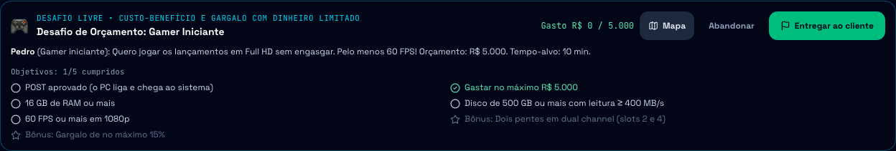
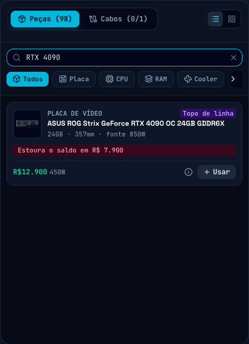
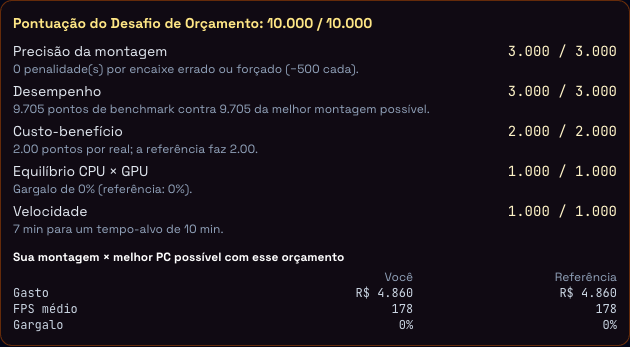
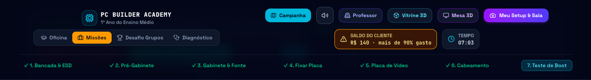

# Relatório da feature: Modo Orçamento (Desafio de Orçamento)

* **Issues:** #66, #67, #68, #69, #70 (primeira entrega do épico #82, Modo Professor)
* **Branch / PR:** `feat/issues-23-a-63`
* **Especificação de origem:** `docs/modo-professor-turmas-ranking-orcamento.md` (seções 6.3, 7.3 e 8) e ADR-014
* **Data:** 2026-11-04

## 1. O que o aluno ganhou

O **Desafio de Orçamento** ensina a decidir com dinheiro limitado. O cliente traz um perfil
(estudos, escritório, jogos em 1080p, jogos em 1440p ou edição de vídeo), um valor e um tempo-alvo.
Gastar tudo não ganha o jogo: ganha quem entrega **desempenho por real**, sem gargalo, atendendo os
requisitos do cliente.

Fluxo no jogo, sem turma e sem internet:

1. **Campanha → trilha Desafio → Desafio de Orçamento.** O aluno escolhe o cliente, o valor e o
   tempo-alvo. A prévia diz na hora se o valor dá para atender o cliente:
   * ❌ "Abaixo do PC mais barato que atende esse cliente (R$ X)": o botão de começar fica desligado;
   * ✅ "Melhor PC possível com R$ Y: ~N FPS em 1080p";
   * ⚠️ "Acima de R$ Z o orçamento deixa de ser desafio".
2. **Briefing** no painel da missão: cliente, pedido, valor e tempo-alvo, com os objetivos ao vivo.
3. **Saldo do cliente no HUD**, ao vivo: verde, âmbar acima de 90% do valor e vermelho ao estourar.
   Cada mudança de faixa tem cor, ícone, texto anunciado por leitor de tela e um som procedural curto
   (Web Audio, sem arquivos), seguindo a equivalência multimodal do AGENTS.md.
4. **Cartão de cada peça** mostra "Cabe no saldo (sobra R$ X)" ou "Estoura o saldo em R$ Y" antes de
   instalar. O cálculo considera a troca da peça da mesma categoria, o pente avulso no slot livre e o
   kit dual nos dois slots.
5. **Montagem normal** na bancada 2D ou 3D, POST e **Entregar ao cliente**.
6. **Debriefing** com o detalhamento dos 10.000 pontos e a tabela "Sua montagem × melhor PC possível"
   (gasto, FPS médio e gargalo).

### Telas

| Prévia do desafio | Briefing do cliente |
| :---: | :---: |
|  |  |

| Cartão da peça antes de instalar | Debriefing contra a referência |
| :---: | :---: |
|  |  |

Saldo do cliente no HUD: no início do desafio e já acima de 90% gasto (âmbar, com ícone e texto).

## 2. Arquitetura

Tudo o que decide é **puro** (`src/engine`, sem React, store ou servidor), para o Modo Professor
reaproveitar o mesmo código no servidor e gravar a pontuação oficial.

| Módulo | Responsabilidade |
| :--- | :--- |
| `budgetChallenge.ts` (#67) | Perfis, `analyzeBudget`, build de referência, `catalogRevision`, `buildBudgetMission` e `spentIfInstalled` |
| `scoring.ts` (#68) | Pontuação do modo (5 partes) e desempates de missão e de orçamento |
| `ranking.ts` (#69) | Ranking da atividade, ranking da turma, destaques e o que cada aluno pode ver |
| `useAssemblyStore` (#70) | `startBudgetChallenge`, desafio ativo persistido, debriefing com `budgetScore` |
| UI (#70) | `BudgetChallengeSetup`, `BudgetBalance` (HUD), selo no cartão, briefing e debriefing |
| `public/sw.js` (#66) | `/api/` nunca passa pelo cache do service worker |

### 2.1 Viabilidade e referência (`analyzeBudget`)
Busca exaustiva CPU × placa (mesmo soquete) × RAM (mesma geração; kit dual ou 1–2 pentes avulsos) ×
GPU (inclui "sem GPU" quando a CPU tem vídeo integrado e o cliente não exige placa dedicada). O cooler,
a fonte, o disco e o gabinete são escolhidos gulosamente: o mais barato que atende. Os critérios são os
do POST: o cooler precisa de TDP ≥ o da CPU e a fonte de ≥ 125% do consumo e ≥ a recomendação da GPU.

A **referência** é a combinação de maior `benchmark.score` com custo ≤ orçamento; no empate, vale a
mais barata. A resposta traz `feasible`, `cheapestCost`/`cheapestBuild`, `reference`, `ceilingCost`
e `catalogRev`, um hash do catálogo que congela a referência no Modo Professor.

Medido no teste: **< 200 ms** com o catálogo real.

### 2.2 Perfis

| Perfil | Requisitos obrigatórios | Bônus |
| :--- | :--- | :--- |
| Estudos | RAM ≥ 8 GB, SSD ≥ 256 GB | Dual channel, fonte recomendada |
| Escritório | RAM ≥ 8 GB, SSD ≥ 500 GB | Zero penalidades, fonte recomendada |
| Jogos 1080p | ≥ 60 FPS em 1080p, RAM ≥ 16 GB, SSD ≥ 500 GB | Dual channel, gargalo ≤ 15% |
| Jogos 1440p | ≥ 60 FPS em 1440p, RAM ≥ 16 GB, NVMe ≥ 1 TB | Gargalo ≤ 15%, CPU ≤ 85 °C |
| Criador | RAM ≥ 32 GB, NVMe ≥ 1 TB, CPU ≤ 85 °C | Dual channel, fonte recomendada |
| Personalizado | Definidos pelo professor (motor pronto; formulário fica para o painel do professor) | Dual channel, zero penalidades |

Todos exigem também `POST_OK` e `BUDGET_MAX`. "SSD" exige leitura ≥ 400 MB/s, o que exclui o HD
mecânico. A missão gerada é avaliada pelo `evaluateMission` que já existia.

### 2.3 Pontuação (máximo 10.000)

| Parte | Máx. | Cálculo |
| :--- | ---: | :--- |
| Precisão | 3.000 | max(500, 3000 − 500 × penalidades) |
| Desempenho | 3.000 | 3000 × min(1, pontuação ÷ pontuação da referência) |
| Custo-benefício | 2.000 | 2000 × min(1, (pontos ÷ gasto) ÷ (pontos da ref. ÷ custo da ref.)); estourou → 0 |
| Equilíbrio | 1.000 | 1000 × fator de gargalo: 1 até o limite, 0 trinta pontos acima |
| Velocidade | 1.000 | 1000 × clamp((2T − t) ÷ T, 0, 1) |

**Decisão tomada na implementação:** o limite do equilíbrio é **10% de gargalo ou o gargalo da
própria referência, o que for maior**. A especificação fixava a curva em 10%→40%. Com isso, a
referência montada sem penalidades no tempo-alvo nem sempre somaria 10.000, como a #68 exige, porque o
melhor PC possível com aquele dinheiro às vezes já tem gargalo. Com a âncora, o critério vale sempre e
um gargalo pior que o da referência continua perdendo pontos.

Envio **não concluído** (requisito não atendido, POST falhou ou orçamento estourado) é pontuado para
aprendizado e marcado `completed: false`, ficando abaixo de todos os concluídos no ranking.

### 2.4 Ranking (para o Modo Professor)
* Por participante: o **melhor** ou o **último** envio (`attemptPolicy`), só entre os `VALIDO`; o
  professor pode incluir os `SINALIZADO`.
* Ordem: concluídos primeiro → pontos ↓ → desempate.
  * Orçamento: menor gasto → menos penalidades → menor tempo → envio mais antigo.
  * Missões: penalidades → tempo → mais antigo.
* Empate exato divide a posição (1º, 1º, 3º).
* Ranking da turma: soma das atividades encerradas e quantas cada aluno fez.
* Destaques: pódio, mais rápido, melhor custo-benefício, montagem limpa (vários) e mais equilibrado.
* Visibilidade (`AO_VIVO`, `AO_ENCERRAR`, `SO_PROFESSOR`): o aluno recebe no máximo o top 10 e a
  própria posição, nunca a lista inteira.

## 3. Acessibilidade
* Perfil em `fieldset` com rádios; valor e tempo com rótulos; prévia em `role="status"`.
* Alvos de 44 × 44 px; tudo operável pelo teclado.
* Saldo do HUD em `role="status"`/`aria-live` com texto, ícone e som. A cor nunca é o único sinal.
* Debriefing com lista de definições (pontos) e tabela com `caption`/`th scope`.

## 4. Testes

| Tipo | Arquivo | O que garante |
| :--- | :--- | :--- |
| Unitário | `budgetChallenge.test.ts` (9) | Perfis; inviável abaixo do mínimo; referência = força bruta independente numa fixture pequena; referência ≤ orçamento e aprovada no POST em todos os perfis; `evaluateMission` cumpre os objetivos com a referência; personalizado; `catalogRevision` estável; **< 200 ms**; saldo do cartão |
| Unitário | `scoring.test.ts` (10) | Referência = 10.000; limites de precisão, velocidade (T, 1,5T, 2T) e equilíbrio (10%/40% e âncora); estouro; gasto = orçamento; desempates |
| Unitário | `ranking.test.ts` (5) | Melhor/último, sinalizados, 1º/1º/3º, ranking da turma, destaques, visibilidade |
| Unitário | `serviceWorker.test.ts` (2) | `/api/` fora do cache (#66); cache com o id do build |
| E2E | `fluxoCompletoOrcamento.spec.ts` | **Fluxo completo só pela interface:** mapa → prévia (recusa R$ 800) → briefing e saldo → "Cabe no saldo" → escolha da placa e montagem completa na bancada 3D da melhor build possível → POST → entrega com **10.000/10.000** → Abrir o PC → PC na mesa |
| E2E | `fluxoCompletoOrcamento.spec.ts` | Orçamento estourado: faixa vermelha, texto "Orçamento estourado em R$ …", envio não concluído e custo-benefício zerado |

Regressão geral no momento da entrega: veja a seção 6.

## 5. Fora desta entrega (próximas issues do épico #82)
A especificação prevê o Modo Professor com servidor: banco Neon pela Vercel, autenticação do
professor, API de turmas, entrada do aluno, envio com pontuação oficial, painel ao vivo, telão,
relatório da atividade e LGPD (#71–#81). Essas issues dependem de criar recursos na conta da Vercel/Neon
e de credenciais, o que não foi feito aqui. O motor desta entrega (`budgetChallenge`, `scoring`,
`ranking`) já é puro e foi escrito para rodar igual no servidor.

## 6. Verificação final
* `tsc --noEmit` limpo; Vitest e Playwright completos; `next build` compila.
* Os números exatos de testes da execução final estão no PR.
